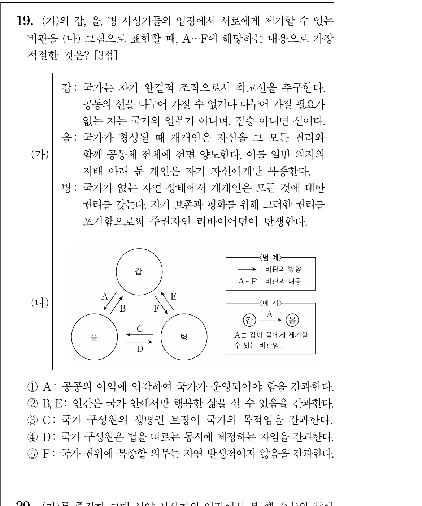
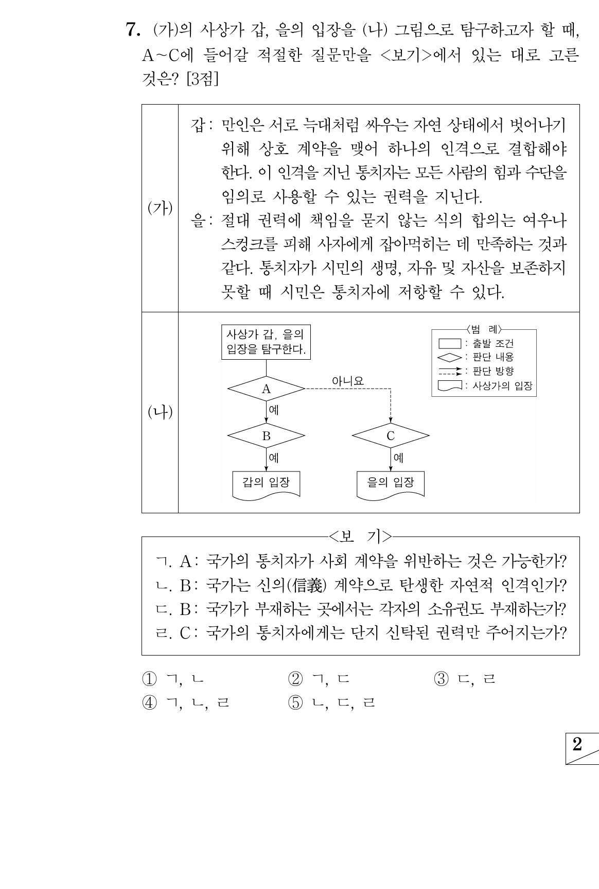
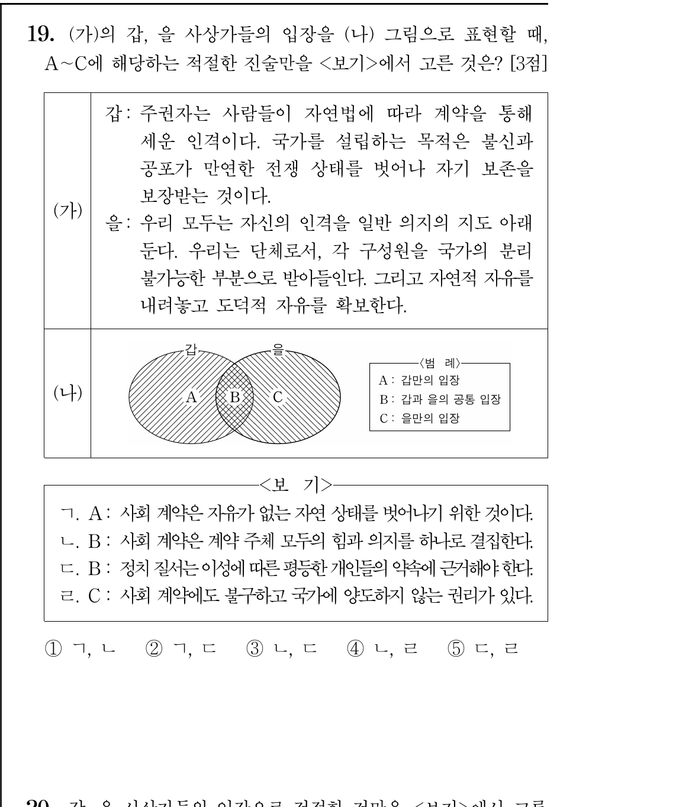
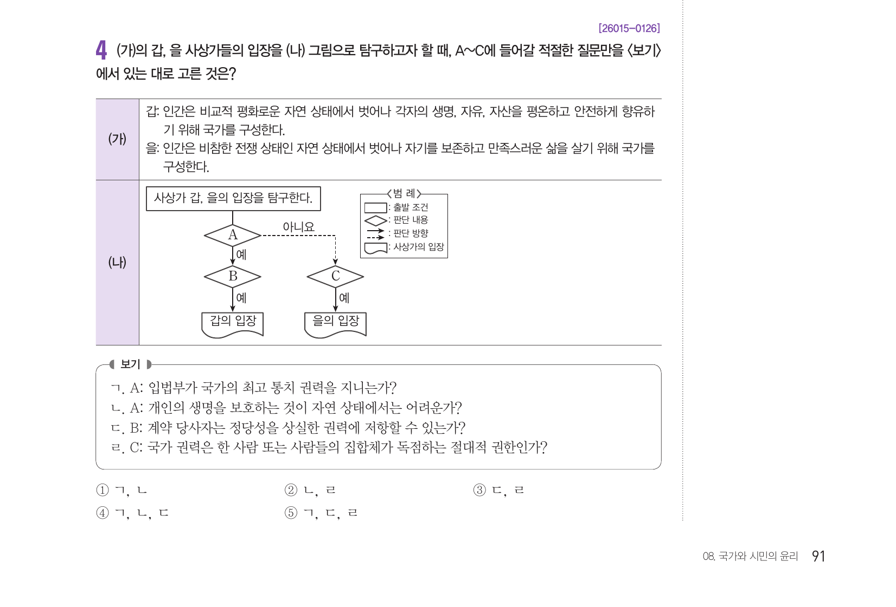

# 그림 문제 – 사회계약설 (홉스 · 로크 · 루소)

평가원·수능 기출과 EBS 수능특강 가운데 **홉스, 로크, 루소가 국가·사회 계약 주제로 나오는 그림 문항 4개**를 정리했다.
함께 출제된 아리스토텔레스도 표에 넣었다.

- 출처: 평가원 공식 정답 및 해설 PDF, EBS 수능특강 정답과 해설
- 표 읽는 법: **O / 예** = 그 사상가가 동의함(긍정) / **X / 아니요** = 동의하지 않음(부정) / **—** = 해설에 언급이 없음. 판정에 필요 없으므로 비워 둠 (배경지식으로 채우지 않음)
- 루소가 **형벌**(사형제, 교정적 정의) 맥락에서 나오는 그림 문항은 이 문서에 넣지 않았다.

**유형별 판정 규칙**

| 유형 | 선지가 맞는 조건 |
|---|---|
| 벤다이어그램 | 그 영역에 속한 사상가는 모두 O, 나머지는 모두 X |
| 순서도 (이 문서의 두 문항은 구조가 같음) | **A**: 갑 **예** + 을 **아니요** / **B** (A에서 '예'로 내려감): 갑 **예** / **C** (A에서 '아니요'로 내려감): 을 **예** |
| 상호 비판 그림 ("X가 Y에게: ~을 간과한다") | 비판하는 쪽 X는 그 내용에 **O**, 비판받는 쪽 Y는 **X** |

---

## 0. 먼저 외울 것: 사회계약설 3인 비교

교과서에 나오는 일반적인 정리다. 이 표의 내용은 시험 판정 근거가 아니며, 판정 근거는 2장에 문항 번호와 함께 적었다.

| 구분 | 홉스 | 로크 | 루소 |
|---|---|---|---|
| 자연 상태 | **만인의 만인에 대한 투쟁**(전쟁 상태). 모든 것에 대한 권리와 자연적 **자유는 있음** | **비교적 평화로운 상태**(자연법이 지배). 생명·자유·재산(자산)에 대한 권리가 있음 | 본래 자유롭고 평등한 상태였으나 사유 재산이 생기면서 불평등해짐 |
| 소유권 | 국가가 없으면 **소유권도 없음** | 자연 상태에서도 소유권이 있음 | — |
| 계약 목적 | **자기 보존**과 평화 | 생명·자유·재산을 안전하게 향유 | **자기 보존**도 목적이다(2023 9월 19번 ③ 해설: 홉스와 루소 모두). 일반 의지로 자유와 평등을 지킴 |
| 권리 처리 | 자연권을 포기하고 주권자에게 양도. 다만 **자기 보존의 권리는 양도하지 않음** | 권력을 통치자에게 **신탁** | **모든 권리를 공동체 전체에 전면 양도** |
| 주권·권력 | 주권자 **리바이어던**(계약으로 만든 **인위적 인격**). 절대 권력 | **입법부**가 최고 권력 | 주권은 인민에게 있음. **일반 의지**의 지배 |
| 통치자와 계약 | 통치자는 계약 당사자가 **아님** → 계약 위반이 불가능 | 통치자는 신탁받은 권력만 가짐 | 구성원은 법을 **따르는 동시에 제정하는 자** |
| 저항권 | 원칙적으로 없음 | 신탁을 위반하면 **저항할 수 있음** | — |
| 자유 | — | — | 자연적 자유를 내려놓고 **도덕적 자유**를 얻음 |

---

## 1. 문항별 선지 판정

### 2023 9월 모평 19번 [상호 비판] — 갑 아리스토텔레스 / 을 루소 / 병 홉스 (정답 ④)

화살표: A 갑→을 · B 을→갑 · C 병→을 · D 을→병 · E 병→갑 · F 갑→병

| 선지 | 비판하는 쪽 | 비판받는 쪽 | 판정 |
|---|---|---|---|
| ① A (아리스토텔레스→루소): 공공의 이익에 입각하여 국가가 운영되어야 함을 간과한다 | 아리스토텔레스 O 공동의 유익을 고려하는 정치 체제가 올바름 | **루소 O** 국가의 행위는 오직 공공의 이익만 대상 | **X** (루소도 O라서 비판이 성립하지 않음) |
| ② B, E (루소·홉스→아리스토텔레스): 인간은 국가 안에서만 행복한 삶을 살 수 있음을 간과한다 | 루소 —, 홉스 — | **아리스토텔레스 O** 국가 밖에서는 행복할 수 없음. 국가 밖에서 사는 자는 짐승 아니면 신 | **X** (비판받는 쪽이 이미 O) |
| ③ C (홉스→루소): 국가 구성원의 생명권 보장이 국가의 목적임을 간과한다 | 홉스 O | **루소 O** 둘 다 자기 보존이 사회 계약의 목적 | **X** (루소도 O) |
| ④ D (루소→홉스): 국가 구성원은 법을 따르는 동시에 제정하는 자임을 간과한다 | 루소 O 구성원은 법의 제정자 | 홉스 X 법의 제정자는 주권자 리바이어던 | **O** |
| ⑤ F (아리스토텔레스→홉스): 국가 권위에 복종할 의무는 자연 발생적이지 않음을 간과한다 | **아리스토텔레스 X** 국가는 자연 발생적이며 복종 의무도 자연적 의무 | 홉스 O 복종 의무는 상호 계약으로 생김 | **X** (비판하는 쪽인 아리스토텔레스가 X, 비판받는 쪽인 홉스가 O라서 성립하지 않음) |

### 2024 수능 7번 [순서도] — 갑 홉스 / 을 로크 (정답 ③ ㄷ, ㄹ)

A: 갑 예 + 을 아니요 · B: 갑 예 · C: 을 예

| 선지 | 홉스 | 로크 | 판정 |
|---|---|---|---|
| ㄱ. A: 국가의 통치자가 사회 계약을 위반하는 것은 가능한가? | **아니요** 통치자는 계약 당사자가 아니므로 위반이 **불가능** | — 해설: 통치자는 계약을 위반해서는 **안 됨**(신탁된 권력일 뿐) | **X** (A는 갑이 '예'여야 함) |
| ㄴ. B: 국가는 신의(信義) 계약으로 탄생한 **자연적** 인격인가? | **아니요** 신의 계약으로 형성된 **인위적** 인격 | — | **X** |
| ㄷ. B: 국가가 부재하는 곳에서는 각자의 소유권도 부재하는가? | **예** 자연 상태에서는 소유권이 없음 | — | **O** |
| ㄹ. C: 국가의 통치자에게는 단지 신탁된 권력만 주어지는가? | — | **예** 구성원은 신탁된 권력만 통치자에게 줌 | **O** |

### 2026 9월 모평 19번 [벤다이어그램] — 갑 홉스 / 을 루소 (정답 ③ ㄴ, ㄷ)

A: 갑만 · B: 갑·을 공통 · C: 을만

| 선지 | 홉스 | 루소 | 판정 |
|---|---|---|---|
| ㄱ. A: 사회 계약은 **자유가 없는** 자연 상태를 벗어나기 위한 것이다 | **X** 자연 상태에서 개인은 자기 힘을 마음대로 쓰는 **자유를 지님** | — | **X** |
| ㄴ. B: 사회 계약은 계약 주체 모두의 힘과 의지를 하나로 결집한다 | O | O | **O** |
| ㄷ. B: 정치 질서는 이성에 따른 평등한 개인들의 약속에 근거해야 한다 | O | O | **O** |
| ㄹ. C: 사회 계약에도 불구하고 국가에 양도하지 않는 권리가 있다 | **O** "홉스의 입장" | **X** 모든 권리를 공동체 전체에 양도 | **X** (C는 을만이어야 함. 사실은 갑만의 입장) |

### EBS 2027 수능특강 126번 [순서도] — 갑 로크 / 을 홉스 (정답 ⑤ ㄱ, ㄷ, ㄹ)

A: 갑 예 + 을 아니요 · B: 갑 예 · C: 을 예. **갑이 로크, 을이 홉스**라서 앞 문항과 순서가 반대다.

| 선지 | 로크 | 홉스 | 판정 |
|---|---|---|---|
| ㄱ. A: 입법부가 국가의 최고 통치 권력을 지니는가? | **예** 입법부가 최고 통치 권력 | **아니요** 군주가 최고 통치 권력 | **O** |
| ㄴ. A: 개인의 생명을 보호하는 것이 자연 상태에서는 어려운가? | — | **예** 자연 상태에서는 생명 보호가 어려움 | **X** (A는 을이 '아니요'여야 함) |
| ㄷ. B: 계약 당사자는 정당성을 상실한 권력에 저항할 수 있는가? | **예** 신탁을 위반한 국가에 저항할 수 있음 | — | **O** |
| ㄹ. C: 국가 권력은 한 사람 또는 사람들의 집합체가 독점하는 절대적 권한인가? | — | **예** 절대 권력인 리바이어던에 합의 | **O** |

---

## 2. 사상가별 O/X 모음 (공식 해설 기준)

1장 4문항에 나온 사상가를 정리했다. 순서도 문항의 '예/아니요'는 O/X로 바꿔 적었다.

**근거 표기**
- **해설**: 그 문항의 평가원(EBS) 해설에 그 사상가의 입장이 직접 적혀 있다.
- 틀린 선지에서 해설이 언급하지 않은 사상가의 입장은 **넣지 않았다**.

### 홉스 (4문항)
| 판정 | 진술 | 문항 | 근거 |
|---|---|---|---|
| O | 국가가 부재하는 곳에서는 각자의 **소유권도 부재**한다 | 2024 수능 7번 ㄷ | 해설: 국가 형성 이전인 자연 상태에서는 개인의 소유권이 없음 |
| O | 개인의 생명을 보호하는 것이 **자연 상태에서는 어렵다** | EBS 수능특강 126번 ㄴ | 해설: 자연 상태에서는 개인의 생명 보호가 어려움 |
| O | 국가 권력은 한 사람 또는 사람들의 집합체가 독점하는 **절대적 권한**이다 | EBS 수능특강 126번 ㄹ | 해설: 절대 권력인 리바이어던의 탄생에 합의 |
| O | 사회 계약에도 불구하고 국가에 **양도하지 않는 권리가 있다** | 2026 9월 19번 ㄹ | 해설: "홉스의 입장이다" |
| O | 사회 계약은 계약 주체 모두의 **힘과 의지를 하나로 결집**한다 | 2026 9월 19번 ㄴ | 해설: 홉스와 루소 모두 |
| O | 정치 질서는 이성에 따른 (자유롭고) **평등한 개인들의 약속**에 근거해야 한다 | 2026 9월 19번 ㄷ | 해설: 홉스와 루소 모두 |
| O | 국가 구성원의 **생명권 보장이 국가의 목적**이다 | 2023 9월 19번 ③ | 해설: 홉스와 루소는 자기 보존을 사회 계약의 목적으로 봄 |
| O | 국가 권위에 복종할 의무는 **자연 발생적이지 않다** (상호 계약으로 생긴다) | 2023 9월 19번 ⑤ | 해설: 복종 의무는 상호 계약에 의해 발생 |
| X | 사회 계약은 **자유가 없는** 자연 상태를 벗어나기 위한 것이다 | 2026 9월 19번 ㄱ | 해설: 자연 상태에서 개인은 생명 유지를 위해 자기 힘을 마음대로 쓰는 **자유를 지님** |
| X | 국가의 통치자가 사회 계약을 **위반하는 것이 가능**하다 | 2024 수능 7번 ㄱ | 해설: 통치자는 사회 계약의 **당사자가 아니므로** 위반이 불가능 |
| X | 국가는 신의 계약으로 탄생한 **자연적** 인격이다 | 2024 수능 7번 ㄴ | 해설: 신의 계약으로 형성되는 **인위적인 인격** |
| X | **입법부**가 국가의 최고 통치 권력을 지닌다 | EBS 수능특강 126번 ㄱ | 해설: **군주**가 최고 통치 권력을 지님 |
| X | 국가 구성원은 법을 따르는 **동시에 제정하는 자**이다 | 2023 9월 19번 ④ | 해설: 개인은 법을 따르는 자이고, 법의 제정자는 주권자 리바이어던 |

### 로크 (2문항)
| 판정 | 진술 | 문항 | 근거 |
|---|---|---|---|
| O | 국가의 통치자에게는 단지 **신탁된 권력**만 주어진다 | 2024 수능 7번 ㄹ | 해설: 자기 보존을 목적으로 계약한 구성원들은 신탁된 권력만 통치자에게 줌 |
| O | **입법부**가 국가의 최고 통치 권력을 지닌다 | EBS 수능특강 126번 ㄱ | 해설: 입법부가 최고 통치 권력 |
| O | 계약 당사자는 정당성을 상실한 권력에 **저항할 수 있다** | EBS 수능특강 126번 ㄷ | 해설: 국가가 생명과 자산을 보호하지 못하면 신탁 위반이므로 저항할 수 있음 |

> **참고:** 2024 수능 7번 ㄱ("통치자가 사회 계약을 위반하는 것은 가능한가?")의 해설은 로크에 대해 "통치자가 사회 계약을 위반해서는 **안 된다**"고만 썼다. 위반이 **가능한지**에 대한 답은 적지 않았으므로 O/X 판정에서 뺐다. 이 선지는 홉스가 '아니요'라서 틀린 것이다.

### 루소 (2문항)
| 판정 | 진술 | 문항 | 근거 |
|---|---|---|---|
| O | 국가 구성원은 법을 따르는 **동시에 제정하는 자**이다 | 2023 9월 19번 ④ | 해설: 개인은 법을 따르는 동시에 법의 제정자여야 함 |
| O | **공공의 이익**에 입각하여 국가가 운영되어야 한다 | 2023 9월 19번 ① | 해설: 국가의 행위는 오직 공공의 이익만을 대상으로 함 |
| O | 국가 구성원의 **생명권 보장이 국가의 목적**이다 | 2023 9월 19번 ③ | 해설: 홉스와 루소는 자기 보존을 사회 계약의 목적으로 봄 |
| O | 사회 계약은 계약 주체 모두의 **힘과 의지를 하나로 결집**한다 | 2026 9월 19번 ㄴ | 해설: 홉스와 루소 모두 |
| O | 정치 질서는 이성에 따른 (자유롭고) **평등한 개인들의 약속**에 근거해야 한다 | 2026 9월 19번 ㄷ | 해설: 홉스와 루소 모두 |
| X | 사회 계약에도 불구하고 국가에 **양도하지 않는 권리가 있다** | 2026 9월 19번 ㄹ | 해설: 사회 계약 시 개인은 **모든 권리를 공동체 전체에 양도** |

### 아리스토텔레스 (1문항: 2023 9월 모평 19번)
| 판정 | 진술 | 문항 | 근거 |
|---|---|---|---|
| O | **공공의 이익**에 입각하여 국가가 운영되어야 한다 | 2023 9월 19번 ① | 해설: 공동의 유익함을 고려하는 정치 체제가 올바름 |
| O | 인간은 **국가 안에서만** 행복한 삶을 살 수 있다 | 2023 9월 19번 ② | 해설: 국가 밖에서는 행복한 삶을 살 수 없음. 국가 밖에서 사는 자는 짐승 아니면 신 |
| X | 국가 권위에 복종할 의무는 **자연 발생적이지 않다** | 2023 9월 19번 ⑤ | 해설: 국가는 자연 발생적이며, 복종 의무는 **자연적 의무** |

## 3. 자주 틀리는 함정

1. **홉스의 자연 상태에도 '자유'는 있다.** 전쟁 상태이지만 각자 자기 힘을 마음대로 쓰는 자연적 자유가 있다. 그래서 "자유가 없는 자연 상태"는 홉스에게 X다 (2026 9월 19번 ㄱ).
2. **홉스도 양도하지 않는 권리를 인정한다.** "양도하지 않는 권리가 있다"는 로크만의 입장처럼 보이지만, 해설은 **홉스의 입장**이라고 했다. 모든 권리를 전면 양도하는 사람은 **루소**다 (2026 9월 19번 ㄹ).
3. **홉스의 통치자는 계약을 위반할 수 없다.** 통치자는 계약 당사자가 아니기 때문이다. "위반이 가능한가?"에 홉스는 '아니요'다 (2024 수능 7번 ㄱ).
4. **홉스의 국가는 '인위적' 인격이다.** "자연적 인격"이라는 한 단어로 오답을 만든다 (2024 수능 7번 ㄴ). 국가가 자연 발생적이라고 보는 사람은 **아리스토텔레스**다 (2023 9월 19번 ⑤).
5. **소유권은 홉스에서 국가와 함께 생긴다.** 국가가 없으면 소유권도 없다 (2024 수능 7번 ㄷ).
6. **최고 권력이 군주냐 입법부냐.** 홉스는 군주(리바이어던), 로크는 입법부다 (EBS 126번 ㄱ). 로크의 권력은 **신탁된** 권력이고, 신탁을 위반하면 **저항권**이 생긴다 (2024 수능 7번 ㄹ, EBS 126번 ㄷ).
7. **홉스와 루소의 공통점을 놓치지 말 것.** 힘과 의지의 결집, 이성에 따른 평등한 개인들의 약속(2026 9월 19번 ㄴ·ㄷ), 생명권 보장이 국가의 목적(2023 9월 19번 ③)은 둘 다 O다.
8. **법을 따르는 자 = 법을 만드는 자**는 루소다. 홉스에서는 법을 만드는 자가 주권자뿐이다 (2023 9월 19번 ④).
9. **순서도는 갑·을 위치부터 확인할 것.** EBS 126번은 갑이 로크, 을이 홉스로, 2024 수능 7번과 순서가 반대다.

> 루소가 형벌 맥락(사형제, 교정적 정의)에서 나오는 그림 문항은 뺐다. 2022 6월 19번, 2022 9월 19번, 2022 수능 9번, 2023 수능 19번, 2024 6월 9번, 2025 6월 19번, 2025 수능 16번, 2026 6월 14번, 2027 6월 9번이다. EBS 수능완성 112007번(홉스·로크·아리스토텔레스, 상호 비판)은 OCR이 깨져 있어 아직 넣지 않았다.
