# 벤다이어그램 – 생태 윤리 (레건 · 테일러 · 레오폴드)

평가원·수능 기출(2021~2027)과 EBS 수능특강 가운데 **레건, 테일러, 레오폴드 중 한 명 이상이 나오는 벤다이어그램 문항 18개**를 정리했다.
같이 출제된 칸트, 싱어, 데카르트, 네스도 표에 함께 넣었다.

- 출처: 평가원 공식 정답 및 해설 PDF(2021~2027), EBS 수능특강 정답과 해설
- 표 읽는 법: **O** = 그 사상가가 동의함 / **X** = 동의하지 않음 / **—** = 해설에 언급이 없음. 판정에 필요 없으므로 비워 둠 (배경지식으로 채우지 않음)
- **판정 규칙**: 선지가 영역에 맞으려면 **그 영역에 속한 사상가는 모두 O이고, 나머지 사상가는 모두 X**여야 한다.
  예를 들어 "갑만의 입장"이면 갑 O·을 X·병 X여야 한다. 셋 다 O인 진술을 "갑만"에 넣으면 틀린 선지다.

---

## 0. 먼저 외울 것: 도덕적 고려 범위

| 사상가 | 도덕적 지위를 갖는 대상 | 기준 | 입장 |
|---|---|---|---|
| 칸트 | 이성적 존재(인간)만 | 이성, 도덕적 행위 능력 | 동물·자연에 관한 의무는 **간접 의무**(인간 자신에 대한 의무로 환원됨) |
| 싱어 | 쾌고 감수 능력이 있는 존재 | 쾌고 감수 능력 | 개체론. 이익을 **평등하게 고려**할 뿐 **동일하게 대우**하는 것은 아님 |
| 레건 | **삶의 주체**(1세 이상의 정상적인 포유류 등) | 내재적 가치, 삶의 주체 | 개체론. 동물의 **권리**를 인정. 직접 의무의 대상은 **개별 동물**(종이 아님) |
| 테일러 | **모든 생명체**(동물·식물 포함, 무생물은 제외) | 목적론적 삶의 중심, 고유한 선 | 개체론. 생명체의 내재적 가치를 인정. 인간이 우월하지 않음. 해악 금지 의무는 **절대적이지 않음** |
| 레오폴드 | 흙·물·식물·동물을 포함하는 **대지 전체**(무생물 포함) | 생명 공동체의 온전성·안정성·아름다움 | **전체론**. 공동체의 선이 개체의 선에 우선. 구성원의 **존속 권리**를 인정하면서도 **이용·관리·개입은 허용** |

> 범위 순서: 칸트(인간) ⊂ 싱어(쾌고 감수 동물) ⊇ 레건(삶의 주체) ⊂ 테일러(모든 생명체) ⊂ 레오폴드(무생물을 포함한 대지)

---

## 1. 문항별 선지 판정

### 2021 6월 모평 15번 — 갑 싱어 / 을 레건 / 병 칸트 (정답 ③ ㄷ, ㄹ)

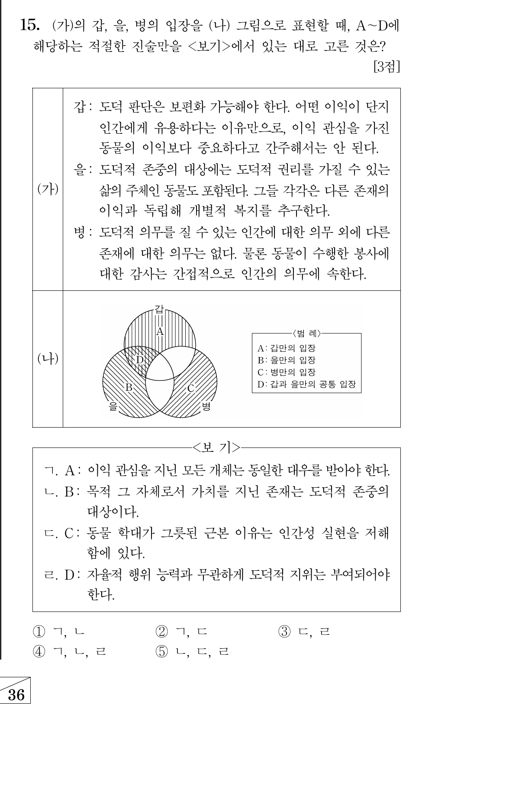

A: 갑만 · B: 을만 · C: 병만 · D: 갑·을만

| 선지 | 싱어 | 레건 | 칸트 | 판정 |
|---|---|---|---|---|
| ㄱ. A: 이익 관심을 지닌 모든 개체는 **동일한 대우**를 받아야 한다 | X 동등한 **고려**이지 동일한 대우가 아님 | — | — | **X** |
| ㄴ. B: 목적 그 자체로서 가치를 지닌 존재는 도덕적 존중의 대상이다 | X | O 내재적 가치 | O 인격 | **X** (레건·칸트 공통) |
| ㄷ. C: 동물 학대가 그릇된 근본 이유는 인간성 실현을 저해함에 있다 | X | X | O 간접 의무 | **O** |
| ㄹ. D: 자율적 행위 능력과 무관하게 도덕적 지위가 부여되어야 한다 | O 쾌고 감수 능력이 기준 | O 도덕적 수동자도 포함 | X 이성이 기준 | **O** |

### 2021 9월 모평 10번 — 갑 데카르트 / 을 레건 / 병 레오폴드 (정답 ③ ㄷ, ㄹ)

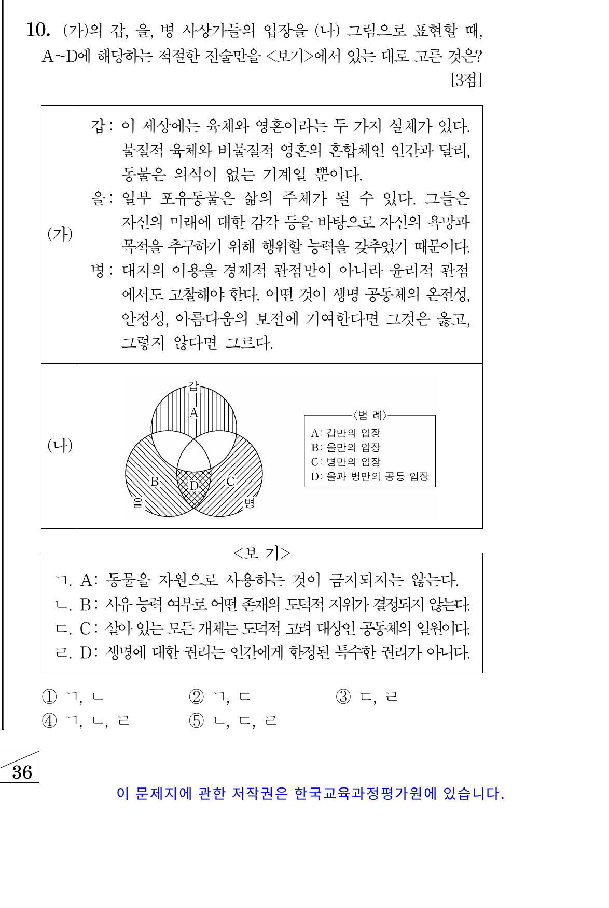

A: 갑만 · B: 을만 · C: 병만 · D: 을·병만

| 선지 | 데카르트 | 레건 | 레오폴드 | 판정 |
|---|---|---|---|---|
| ㄱ. A: 동물을 자원으로 사용하는 것이 금지되지는 않는다 | O 동물은 기계 | — | **O 자원 사용 허용** | **X** (레오폴드도 O) |
| ㄴ. B: 사유 능력 여부로 도덕적 지위가 결정되지 않는다 | — | O | **O** | **X** (을·병 공통) |
| ㄷ. C: 살아 있는 모든 개체는 도덕적 고려 대상인 공동체의 일원이다 | X | X 삶의 주체만 | O | **O** |
| ㄹ. D: 생명에 대한 권리는 인간에게 한정된 권리가 아니다 | X | O 동물의 권리 | O 존속 권리 | **O** |

### 2022 6월 모평 10번 — 갑 칸트 / 을 레건 / 병 레오폴드 (정답 ⑤ ㄷ, ㄹ)

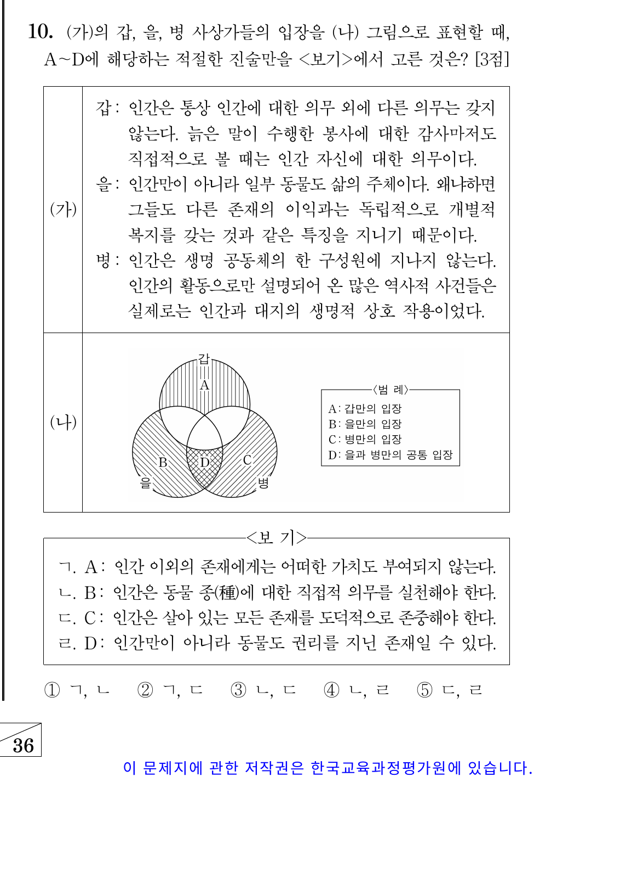

A: 갑만 · B: 을만 · C: 병만 · D: 을·병만

| 선지 | 칸트 | 레건 | 레오폴드 | 판정 |
|---|---|---|---|---|
| ㄱ. A: 인간 이외의 존재에게는 **어떠한 가치도** 부여되지 않는다 | X 도구적 가치는 인정 | — | — | **X** |
| ㄴ. B: 인간은 동물 **종(種)**에 대한 직접적 의무를 실천해야 한다 | — | X **개별 동물**에 대한 의무 | — | **X** |
| ㄷ. C: 인간은 살아 있는 모든 존재를 도덕적으로 존중해야 한다 | X | X 삶의 주체만 | O | **O** |
| ㄹ. D: 인간만이 아니라 동물도 권리를 지닌 존재일 수 있다 | X | O | O 존속 권리 | **O** |

### 2022 9월 모평 15번 — 갑 칸트 / 을 싱어 / 병 레오폴드 (정답 ③ ㄴ, ㄹ)

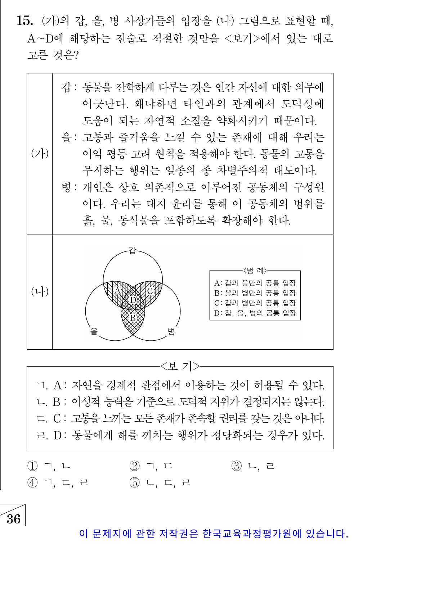

A: 갑·을만 · B: 을·병만 · C: 갑·병만 · D: 갑·을·병

| 선지 | 칸트 | 싱어 | 레오폴드 | 판정 |
|---|---|---|---|---|
| ㄱ. A: 자연을 경제적 관점에서 이용하는 것이 허용될 수 있다 | — | — | **O** 경제적 관점만으로 보지는 말라는 것 | **X** (레오폴드도 O라서 '갑·을만'이 아님) |
| ㄴ. B: 이성적 능력을 기준으로 도덕적 지위가 결정되지는 않는다 | X | O | O | **O** |
| ㄷ. C: 고통을 느끼는 모든 존재가 존속할 권리를 갖는 것은 아니다 | — | — | **X 구성원 모두 존속 권리** | **X** |
| ㄹ. D: 동물에게 해를 끼치는 행위가 정당화되는 경우가 있다 | O | O | O | **O** |

### 2022 수능 14번 — 갑 테일러 / 을 칸트 / 병 레건 (정답 ⑤ ㄴ, ㄷ, ㄹ)

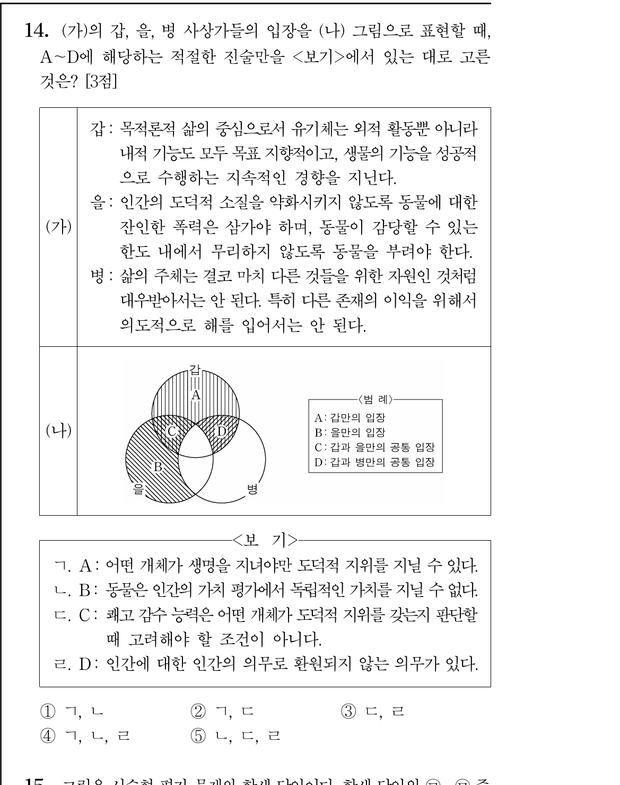

A: 갑만 · B: 을만 · C: 갑·을만 · D: 갑·병만

| 선지 | 테일러 | 칸트 | 레건 | 판정 |
|---|---|---|---|---|
| ㄱ. A: 어떤 개체가 생명을 지녀야만 도덕적 지위를 지닐 수 있다 | O | O 이성적 존재 = 생명체 | O 삶의 주체 = 생명체 | **X** (셋 공통) |
| ㄴ. B: 동물은 인간의 가치 평가에서 독립적인 가치를 지닐 수 없다 | X 고유한 선 | O 수단적 가치만 | X 내재적 가치 | **O** |
| ㄷ. C: 쾌고 감수 능력은 도덕적 지위를 판단할 때 고려할 조건이 아니다 | O 모든 생명체 | O 이성이 기준 | **X 쾌고 감수 능력은 삶의 주체의 조건** | **O** |
| ㄹ. D: 인간에 대한 의무로 환원되지 않는 의무가 있다 | O | X 간접 의무 | O | **O** |

### 2023 6월 모평 19번 — 갑 싱어 / 을 칸트 / 병 레오폴드 (정답 ① ㄱ, ㄷ)

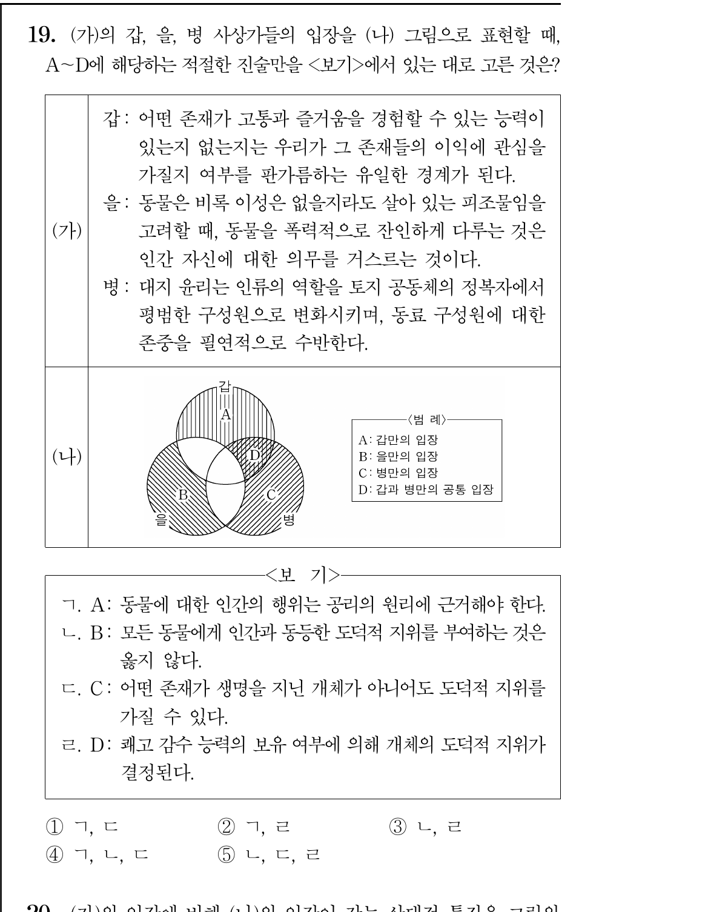

A: 갑만 · B: 을만 · C: 병만 · D: 갑·병만

| 선지 | 싱어 | 칸트 | 레오폴드 | 판정 |
|---|---|---|---|---|
| ㄱ. A: 동물에 대한 행위는 공리의 원리에 근거해야 한다 | O | X | X 대지 윤리 | **O** |
| ㄴ. B: 모든 동물에게 인간과 동등한 도덕적 지위를 주는 것은 옳지 않다 | O 쾌고 감수 능력이 없는 동물은 제외 | O | — | **X** (칸트만이 아님) |
| ㄷ. C: 생명을 지닌 개체가 아니어도 도덕적 지위를 가질 수 있다 | X | X | **O 대지·무생물** | **O** |
| ㄹ. D: 쾌고 감수 능력의 보유 여부로 도덕적 지위가 결정된다 | O | X | **X** | **X** (싱어만) |

### 2023 9월 모평 10번 — 갑 레오폴드 / 을 테일러 / 병 레건 (정답 ③ ㄴ, ㄷ)

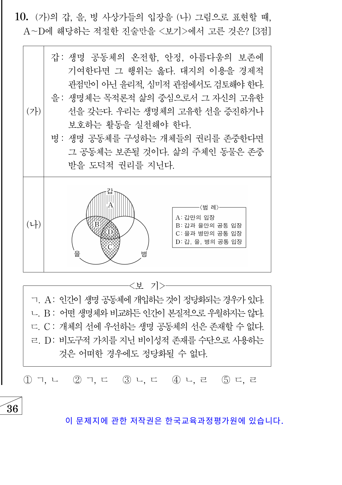

A: 갑만 · B: 갑·을만 · C: 을·병만 · D: 갑·을·병

| 선지 | 레오폴드 | 테일러 | 레건 | 판정 |
|---|---|---|---|---|
| ㄱ. A: 인간이 생명 공동체에 개입하는 것이 정당화되는 경우가 있다 | O 공동체 보전 | **O 생명 개체의 선을 증진하는 개입** | — | **X** (갑만이 아님) |
| ㄴ. B: 어떤 생명체와 비교하든 인간이 본질적으로 우월하지는 않다 | O | O | **X 삶의 주체와의 비교에 한정** | **O** |
| ㄷ. C: 개체의 선에 우선하는 생명 공동체의 선은 존재할 수 없다 | **X 전체론** | O 개체론 | O 개체론 | **O** |
| ㄹ. D: 비도구적 가치를 지닌 비이성적 존재를 수단으로 쓰는 것은 **어떠한 경우에도** 정당화될 수 없다 | **X 동식물 자원 사용 허용** | — | — | **X** |

### 2023 수능 10번 — 갑 테일러 / 을 칸트 / 병 싱어 (정답 ⑤ ㄷ, ㄹ)

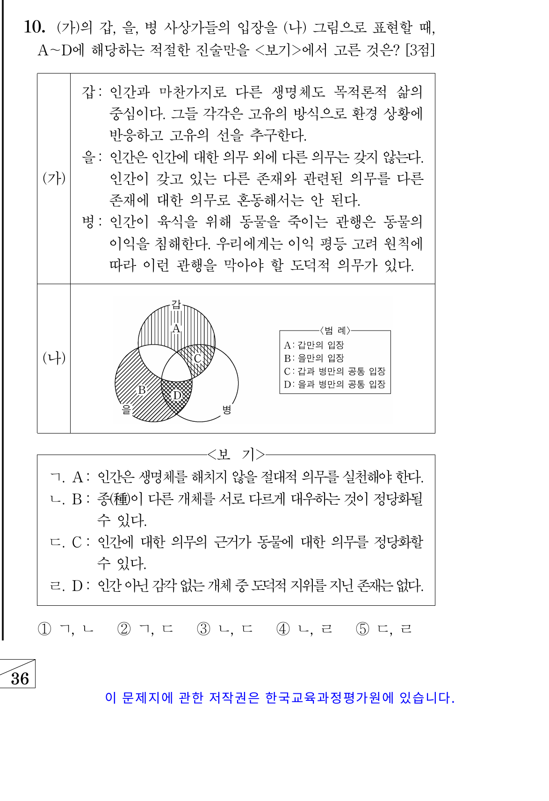

A: 갑만 · B: 을만 · C: 갑·병만 · D: 을·병만

| 선지 | 테일러 | 칸트 | 싱어 | 판정 |
|---|---|---|---|---|
| ㄱ. A: 생명체를 해치지 않을 **절대적** 의무를 실천해야 한다 | **X 생존을 위한 살생은 허용** | — | — | **X** |
| ㄴ. B: 종이 다른 개체를 서로 다르게 대우하는 것이 정당화될 수 있다 | — | O | **O 평등한 고려 ≠ 동등 대우** | **X** (칸트만이 아님) |
| ㄷ. C: 인간에 대한 의무의 근거가 동물에 대한 의무를 정당화할 수 있다 | O 내재적 존엄성 | X 이성 | O 쾌고 감수 능력 | **O** |
| ㄹ. D: 인간 아닌 감각 없는 개체 중 도덕적 지위를 지닌 존재는 없다 | **X 식물도 지위** | O | O | **O** |

### 2024 6월 모평 15번 — 갑 테일러 / 을 칸트 / 병 레오폴드 (정답 ② ㄱ, ㄷ)

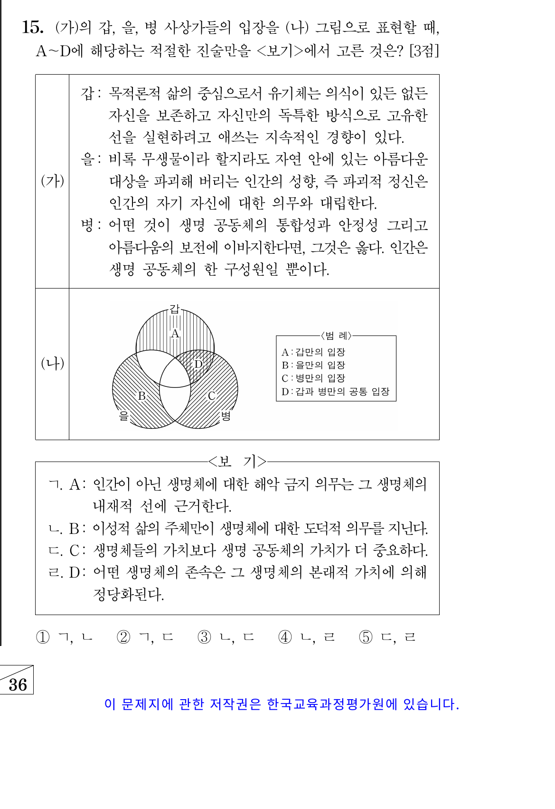

A: 갑만 · B: 을만 · C: 병만 · D: 갑·병만

| 선지 | 테일러 | 칸트 | 레오폴드 | 판정 |
|---|---|---|---|---|
| ㄱ. A: 비인간 생명체에 대한 해악 금지 의무는 그 생명체의 내재적 선에 근거한다 | O | X 인간을 대하는 태도 때문 | X 공동체 기준 | **O** |
| ㄴ. B: 이성적 삶의 주체만이 생명체에 대한 도덕적 의무를 지닌다 | O 의무를 지는 쪽은 인간 | **X 생명체에 대한 직접 의무 없음** | O | **X** (갑·병 공통) |
| ㄷ. C: 생명체들의 가치보다 생명 공동체의 가치가 더 중요하다 | X 개체론 | X | O 전체론 | **O** |
| ㄹ. D: 생명체의 존속은 그 생명체의 본래적 가치로 정당화된다 | O | O 이성적 존재의 존엄 | O 구성원은 존속할 가치가 있음 | **X** (셋 공통) |

### 2024 9월 모평 10번 — 갑 테일러 / 을 레오폴드 / 병 싱어 (정답 ③ ㄷ, ㄹ)

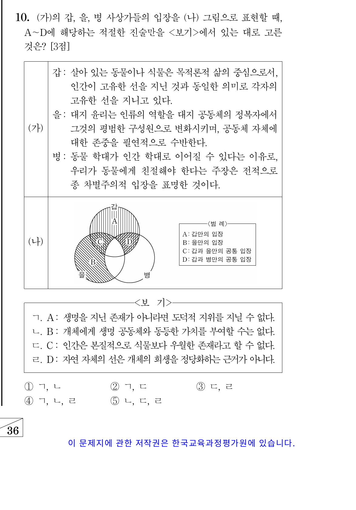

A: 갑만 · B: 을만 · C: 갑·을만 · D: 갑·병만

| 선지 | 테일러 | 레오폴드 | 싱어 | 판정 |
|---|---|---|---|---|
| ㄱ. A: 생명을 지닌 존재가 아니라면 도덕적 지위를 지닐 수 없다 | O | X 무생물도 지위 (2023 6월 19번 ㄷ 해설) | **O 동물도 생명체** | **X** (갑·병 공통) |
| ㄴ. B: 개체에게 생명 공동체와 동등한 가치를 부여할 수는 없다 | **O 개체에만 가치(공동체와 동등하지 않음)** | O 공동체 우선 | — | **X** (을만이 아님) |
| ㄷ. C: 인간은 본질적으로 식물보다 우월하다고 할 수 없다 | O | O | X | **O** |
| ㄹ. D: 자연 자체의 선은 개체의 희생을 정당화하는 근거가 아니다 | O 개체론 | X 전체론 | O 개체론 | **O** |

### 2024 수능 15번 — 갑 칸트 / 을 싱어 / 병 레오폴드 (정답 ② ㄱ, ㄷ)

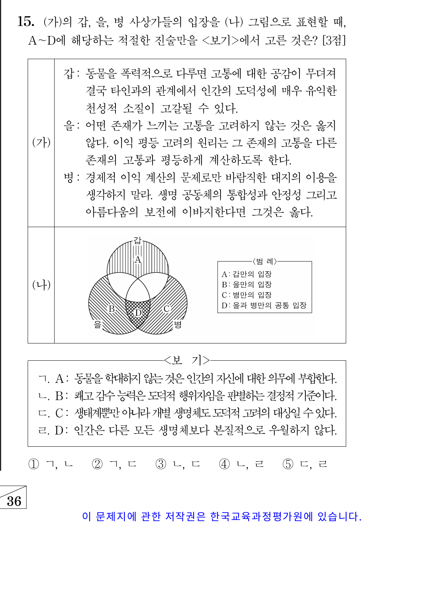

A: 갑만 · B: 을만 · C: 병만 · D: 을·병만

| 선지 | 칸트 | 싱어 | 레오폴드 | 판정 |
|---|---|---|---|---|
| ㄱ. A: 동물을 학대하지 않는 것은 인간 자신에 대한 의무에 부합한다 | O | X 동물의 이익 때문 | X 공동체 때문 | **O** |
| ㄴ. B: 쾌고 감수 능력은 **도덕적 행위자**를 판별하는 결정적 기준이다 | — | **X 도덕적 고려 대상의 기준일 뿐** | — | **X** |
| ㄷ. C: 생태계뿐만 아니라 개별 생명체도 도덕적 고려의 대상일 수 있다 | X | X 생태계는 대상이 아님 | O | **O** |
| ㄹ. D: 인간은 다른 모든 생명체보다 본질적으로 우월하지 않다 | — | **X 식물보다는 우월** | O (2023 9월 10번 ㄴ 해설) | **X** |

### 2025 6월 모평 9번 — 갑 레건 / 을 테일러 / 병 칸트 (정답 ④ ㄴ, ㄹ)

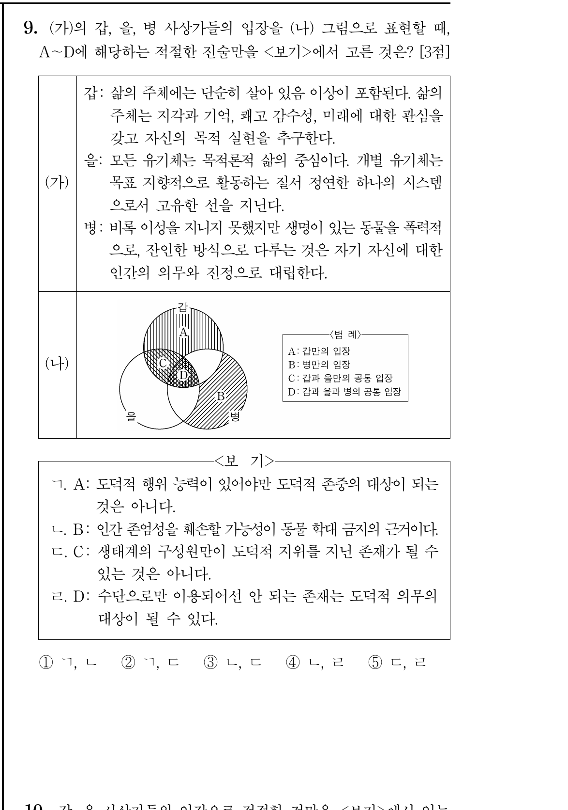

A: 갑만 · B: 병만 · C: 갑·을만 · D: 갑·을·병

| 선지 | 레건 | 테일러 | 칸트 | 판정 |
|---|---|---|---|---|
| ㄱ. A: 도덕적 행위 능력이 있어야만 도덕적 존중의 대상이 되는 것은 아니다 | O | **O** | X | **X** (갑·을 공통이므로 C 영역) |
| ㄴ. B: 인간 존엄성을 훼손할 가능성이 동물 학대 금지의 근거이다 | X 내재적 가치 | X 고유한 선 | O | **O** |
| ㄷ. C: 생태계의 구성원만이 도덕적 지위를 지닐 수 있는 것은 아니다 | X | X | X | **X** (모두 생태계 구성원에게만 지위를 줌) |
| ㄹ. D: 수단으로만 이용되어선 안 되는 존재는 도덕적 의무의 대상이 될 수 있다 | O 내재적 가치를 지닌 존재 | O 모든 생명체 | O 인간 | **O** |

### 2025 수능 9번 — 갑 칸트 / 을 레오폴드 / 병 싱어 (정답 ④ ㄱ, ㄷ, ㄹ)

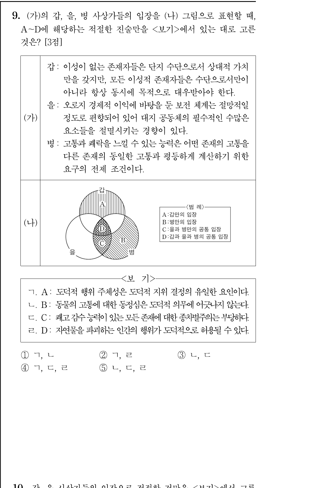

A: 갑만 · B: 병만 · C: 을·병만 · D: 갑·을·병

| 선지 | 칸트 | 레오폴드 | 싱어 | 판정 |
|---|---|---|---|---|
| ㄱ. A: 도덕적 행위 주체성은 도덕적 지위 결정의 **유일한** 요인이다 | O | X 대지도 지위 | X 쾌고 감수 능력 | **O** |
| ㄴ. B: 동물의 고통에 대한 동정심은 도덕적 의무에 어긋나지 않는다 | **O** | — | O | **X** (싱어만이 아님) |
| ㄷ. C: 쾌고 감수 능력이 있는 모든 존재에 대한 종 차별주의는 부당하다 | X | O 인간은 평범한 구성원 | O | **O** |
| ㄹ. D: 자연물을 파괴하는 행위가 도덕적으로 허용될 수 있다 | O 수단적 가치 | **O 자원 이용 허용** | O | **O** |

### 2026 6월 모평 10번 — 갑 테일러 / 을 레오폴드 / 병 싱어 (정답 ⑤ ㄷ, ㄹ)

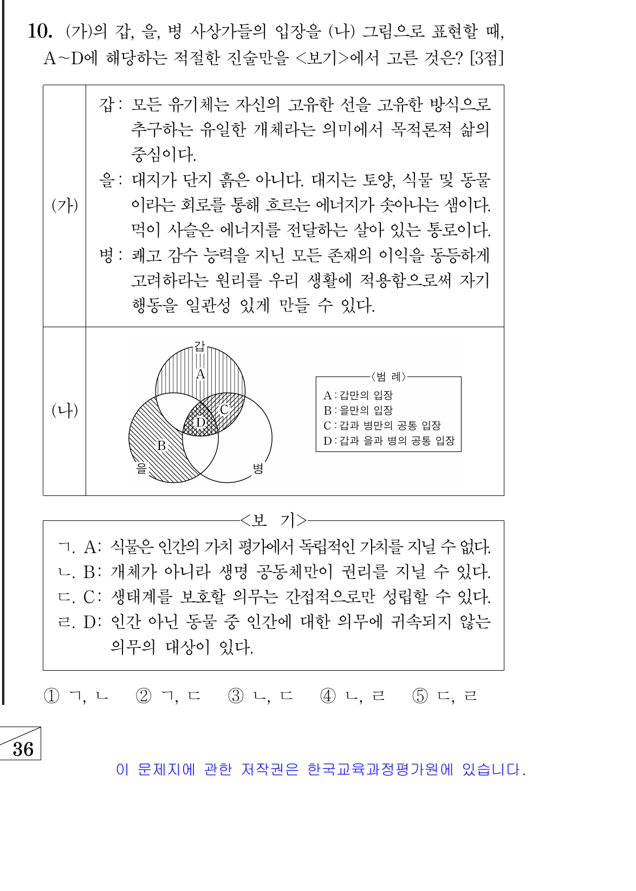

A: 갑만 · B: 을만 · C: 갑·병만 · D: 갑·을·병

| 선지 | 테일러 | 레오폴드 | 싱어 | 판정 |
|---|---|---|---|---|
| ㄱ. A: 식물은 인간의 가치 평가에서 독립적인 가치를 지닐 수 없다 | **X 식물도 본래적 가치** | — | — | **X** |
| ㄴ. B: 개체가 아니라 생명 공동체**만이** 권리를 지닐 수 있다 | — | **X 구성원도 존속 권리** | — | **X** |
| ㄷ. C: 생태계를 보호할 의무는 **간접적으로만** 성립할 수 있다 | O 생명체를 위해 | **X 생태계에 대한 직접 의무** | O 쾌고 감수 존재를 위해 | **O** |
| ㄹ. D: 인간 아닌 동물 중 인간에 대한 의무로 귀속되지 않는 의무의 대상이 있다 | O | O | O | **O** |

### 2026 9월 모평 14번 — 갑 싱어 / 을 칸트 / 병 레오폴드 (정답 ③ ㄴ, ㄷ)

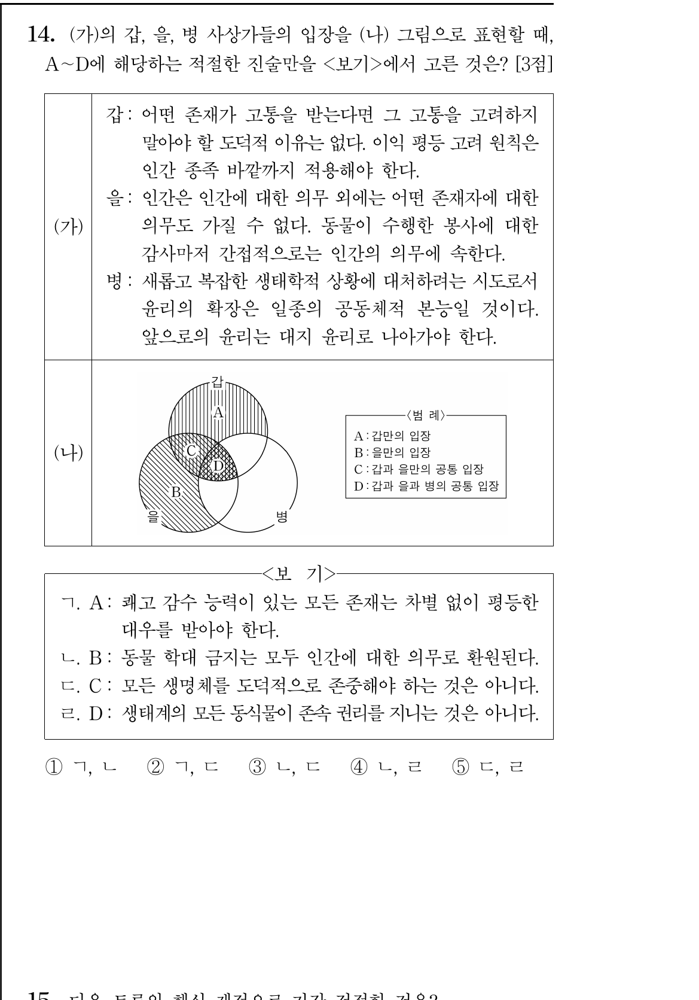

A: 갑만 · B: 을만 · C: 갑·을만 · D: 갑·을·병

| 선지 | 싱어 | 칸트 | 레오폴드 | 판정 |
|---|---|---|---|---|
| ㄱ. A: 쾌고 감수 능력이 있는 모든 존재는 차별 없이 **평등한 대우**를 받아야 한다 | **X 평등한 고려일 뿐** | — | — | **X** |
| ㄴ. B: 동물 학대 금지는 모두 인간에 대한 의무로 환원된다 | X | O | X | **O** |
| ㄷ. C: 모든 생명체를 도덕적으로 존중해야 하는 것은 아니다 | O 쾌고 감수 동물만 | O 인간만 | **X 모든 생명체 존중** | **O** |
| ㄹ. D: 생태계의 모든 동식물이 존속 권리를 지니는 것은 아니다 | — | — | **X 구성원은 존속 권리** | **X** |

### 2027 6월 모평 14번 — 갑 싱어 / 을 레오폴드 (정답 ③ ㄴ, ㄷ)

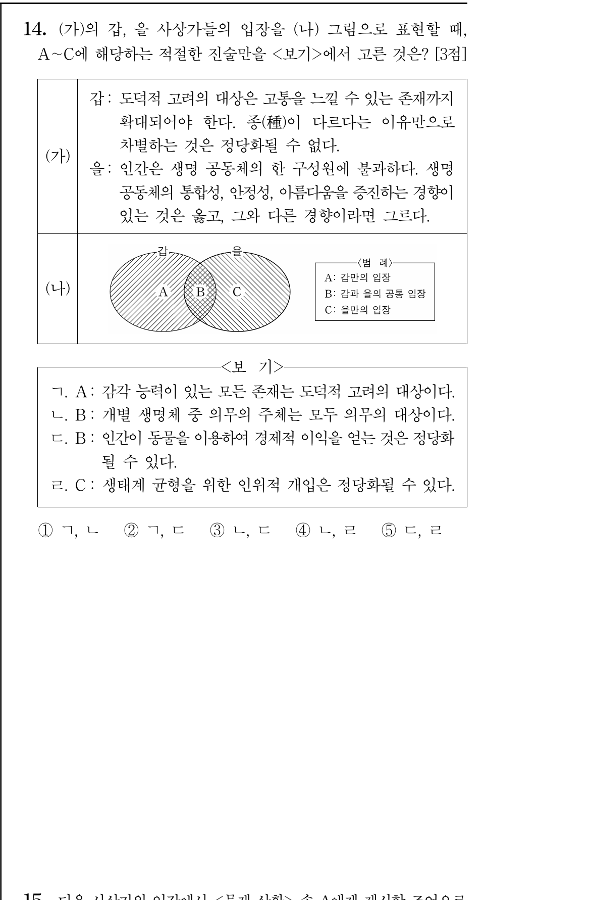

A: 갑만 · B: 갑·을 공통 · C: 을만

| 선지 | 싱어 | 레오폴드 | 판정 |
|---|---|---|---|
| ㄱ. A: 감각 능력이 있는 모든 존재는 도덕적 고려의 대상이다 | O | **O 감각 존재를 포함한 구성원 모두** | **X** (공통이므로 B 영역) |
| ㄴ. B: 개별 생명체 중 의무의 주체는 모두 의무의 대상이다 | O | O | **O** |
| ㄷ. B: 동물을 이용해 경제적 이익을 얻는 것은 정당화될 수 있다 | O 인간의 이익이 더 크면 | O 공동체 증진에 맞으면 | **O** |
| ㄹ. C: 생태계 균형을 위한 인위적 개입은 정당화될 수 있다 | **O** | O | **X** (공통이므로 B 영역) |

### 2027 9월 모평 11번 — 갑 테일러 / 을 칸트 / 병 싱어 (정답 ⑤)

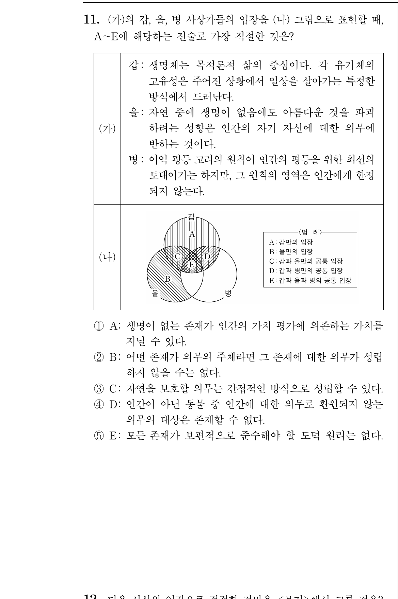

A: 갑만 · B: 을만 · C: 갑·을만 · D: 갑·병만 · E: 갑·을·병

| 선지 | 테일러 | 칸트 | 싱어 | 판정 |
|---|---|---|---|---|
| ① A: 생명이 없는 존재가 인간의 가치 평가에 의존하는 가치를 지닐 수 있다 | O 수단적 가치 | O | O | **X** (셋 공통) |
| ② B: 의무의 주체라면 그 존재에 대한 의무가 성립한다 | O | O | O | **X** (셋 공통) |
| ③ C: 자연을 보호할 의무는 간접적으로 성립할 수 있다 | O 생명체를 위해 | O 인간을 위해 | O 쾌고 감수 존재를 위해 | **X** (셋 공통) |
| ④ D: 인간이 아닌 동물 중 인간에 대한 의무로 환원되지 않는 의무의 대상은 **없다** | X | O | X | **X** (칸트만) |
| ⑤ E: 모든 존재가 보편적으로 준수해야 할 도덕 원리는 없다 | O 모든 존재가 행위 주체는 아님 | O | O | **O** |

### EBS 2027 수능특강 177번 — 갑 레건 / 을 네스 (정답 ① ㄱ, ㄴ)

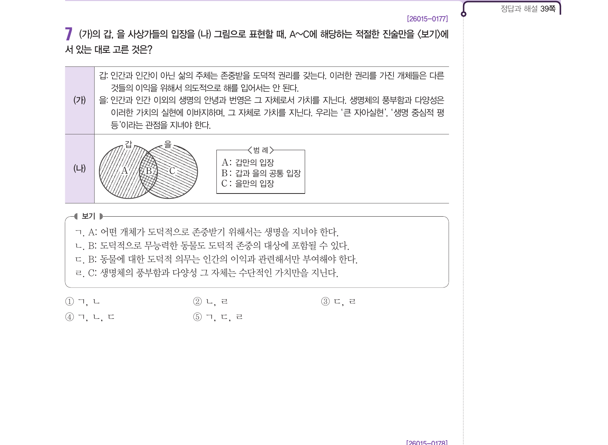

A: 갑만 · B: 갑·을 공통 · C: 을만

| 선지 | 레건 | 네스 | 판정 |
|---|---|---|---|
| ㄱ. A: 도덕적으로 존중받기 위해서는 생명을 지녀야 한다 | O 삶의 주체 | X 무생물을 포함한 생태계 | **O** |
| ㄴ. B: 도덕적으로 무능력한 동물도 도덕적 존중의 대상에 포함될 수 있다 | O | O | **O** |
| ㄷ. B: 동물에 대한 의무는 인간의 이익과 관련해서만 부여해야 한다 | X | X | **X** |
| ㄹ. C: 생명체의 풍부함과 다양성은 수단적인 가치만 지닌다 | — | X 그 자체로 가치 | **X** |

---

## 2. 사상가별 O/X 모음 (공식 해설 기준으로 재검증)

1장 18문항에 나온 사상가 7명을 0장과 같은 순서로 정리했다. 괄호 안 숫자는 그 사상가가 나온 문항 수다.

**근거 표기**
- **해설**: 그 문항의 평가원(EBS) 해설에 그 사상가의 입장이 직접 적혀 있다.
- **해설(함의)**: 해설이 "~도 그렇게 보았다", "~와 ~의 공통점이다"처럼 써서, 그 사상가의 입장이 문장에서 바로 따라 나온다.
- **정답**: 해설에는 이름이 없지만, 정답 선지가 들어간 영역(예: "병만의 입장")으로 판정이 정해진다. 해당 영역에 속한 사상가는 O이고, 나머지는 X다.
- 틀린 선지에서 해설이 언급하지 않은 사상가의 입장은 **넣지 않았다**. 그런 선지는 언급된 사상가 한 명 때문에 틀린 것일 수 있어서, 다른 사상가의 입장은 알 수 없다.

### 칸트 (12문항)
| 판정 | 진술 | 문항 | 근거 |
|---|---|---|---|
| O | 동물 학대가 그릇된 근본 이유는 **인간성 실현을 저해**하기 때문이다 | 2021 6월 15번 ㄷ | 해설: 칸트는 동물 학대가 그릇된 근본 이유를 인간성 실현 저해로 봄 |
| O | 동물을 학대하지 않는 것은 **인간 자신에 대한 의무**에 부합한다 | 2024 수능 15번 ㄱ | 해설: "칸트에게만 옳은 진술". 잔혹함은 도덕성에 이로운 소질을 약화시킴 |
| O | **인간 존엄성을 훼손할 가능성**이 동물 학대 금지의 근거다 | 2025 6월 9번 ㄴ | 해설: 동물 학대는 인간 존엄성 훼손으로 이어질 수 있음 |
| O | 동물 학대 금지는 모두 **인간에 대한 의무로 환원**된다 | 2026 9월 14번 ㄴ | 해설: 간접 의무로서 인간에 대한 의무로 환원됨. 칸트만의 입장 |
| O | 인간이 아닌 동물 중 인간에 대한 의무로 환원되지 않는 의무의 대상은 **없다** | 2027 9월 11번 ④ | 해설: 칸트는 동물에 관한 의무가 인간에 대한 의무로 환원된다고 봄 |
| O | 동물은 인간의 가치 평가에서 독립적인 가치를 지닐 수 **없다** | 2022 수능 14번 ㄴ | 해설: 동물은 인간의 가치 평가에 의한 **수단적 가치만** 지님 |
| O | 생명이 없는 존재도 인간의 가치 평가에 의존하는 가치(수단적 가치)를 지닐 수 있다 | 2027 9월 11번 ① | 해설: 테일러·칸트·싱어 모두 무생물의 수단적 가치를 인정 |
| O | 자연물을 파괴하는 인간의 행위가 도덕적으로 **허용될 수 있다** | 2025 수능 9번 ㄹ | 해설: 이성이 없는 자연물은 수단적 가치만 지님 |
| O | 동물에게 해를 끼치는 행위가 정당화되는 경우가 있다 | 2022 9월 15번 ㄹ | 해설: 칸트·싱어·레오폴드 모두 |
| O | 목적 그 자체로서 가치를 지닌 존재는 도덕적 존중의 대상이다 | 2021 6월 15번 ㄴ | 해설: "레건과 칸트의 공통점" |
| O | 수단으로만 이용되어선 안 되는 존재는 도덕적 의무의 대상이 될 수 있다 | 2025 6월 9번 ㄹ | 해설: 칸트에게는 **인간**이 그런 존재 |
| O | **도덕적 행위 주체성**이 도덕적 지위를 결정하는 **유일한** 요인이다 | 2025 수능 9번 ㄱ | 해설: 행위 주체성은 이성을 지닌 인간에게 있음 |
| O | 쾌고 감수 능력은 도덕적 지위를 판단하는 조건이 **아니다** | 2022 수능 14번 ㄷ | 해설: 이성 능력만이 지위 결정 조건 |
| O | 어떤 개체가 생명을 지녀야만 도덕적 지위를 지닐 수 있다 | 2022 수능 14번 ㄱ | 해설: 이성 능력을 지닌다는 것은 생명을 지녔음을 의미 |
| O | 생명체의 존속은 그 생명체의 본래적 가치로 정당화된다 | 2024 6월 15번 ㄹ | 해설: 이성을 지닌 존재만 지위를 가지며, 이성적 존재는 생명을 지님 |
| O | 인간 아닌 감각 없는 개체 중 도덕적 지위를 지닌 존재는 없다 | 2023 수능 10번 ㄹ | 해설: 칸트와 싱어만의 공통 입장 |
| O | 모든 생명체를 도덕적으로 존중해야 하는 것은 **아니다** | 2026 9월 14번 ㄷ | 해설: 이성적 존재인 인간만 존중 |
| O | 종이 다른 개체를 서로 다르게 대우하는 것이 정당화될 수 있다 | 2023 수능 10번 ㄴ | 해설: 종이 다른 인간과 동물을 다르게 대우하는 것은 정당 |
| O | 모든 동물에게 인간과 동등한 도덕적 지위를 부여하는 것은 옳지 않다 | 2023 6월 19번 ㄴ | 해설(함의): "싱어도 동의"(칸트만의 영역 B에 넣은 진술) |
| O | 동물의 고통에 대한 **동정심**은 도덕적 의무에 어긋나지 않는다 | 2025 수능 9번 ㄴ | 해설: 동정심은 인간 의무에 어긋나지 않음 |
| O | 자연을 보호할 의무는 간접적으로 성립할 수 있다 | 2027 9월 11번 ③ | 해설: 칸트는 **인간을 위해** |
| O | 의무의 주체라면 그 존재에 대한 의무가 성립한다 | 2027 9월 11번 ② | 해설: 테일러·칸트·싱어 모두 |
| O | 모든 존재가 보편적으로 준수해야 할 도덕 원리는 없다 | 2027 9월 11번 ⑤ | 해설: 모든 존재를 도덕적 행위 주체로 보지 않음 |
| X | 인간 이외의 존재에게는 **어떠한 가치도** 부여되지 않는다 | 2022 6월 10번 ㄱ | 해설: 인간 이외의 존재에게 **도구적 가치**는 부여될 수 있음 |
| X | 동물도 권리를 지닌 존재일 수 있다 | 2022 6월 10번 ㄹ | 해설: 칸트는 인간만 권리를 지닌다고 봄 |
| X | 살아 있는 모든 존재를 도덕적으로 존중해야 한다 | 2022 6월 10번 ㄷ | 해설: 칸트·레건은 그렇게 주장하지 않음 |
| X | 생태계뿐만 아니라 개별 생명체도 도덕적 고려의 대상일 수 있다 | 2024 수능 15번 ㄷ | 해설: 칸트는 이성적 존재만 도덕적 고려 대상 |
| X | 이성적 능력을 기준으로 도덕적 지위가 결정되지는 **않는다** | 2022 9월 15번 ㄴ | 해설: 칸트는 이성적 능력이 지위 기준 |
| X | 자율적 행위 능력과 무관하게 도덕적 지위가 부여되어야 한다 | 2021 6월 15번 ㄹ | 정답: 싱어·레건만의 공통 영역 D |
| X | 도덕적 행위 능력이 있어야만 도덕적 존중의 대상이 되는 것은 아니다 | 2025 6월 9번 ㄱ | 해설: "칸트와 달리 레건과 테일러는" |
| X | 인간에 대한 인간의 의무로 환원되지 않는 의무가 있다 | 2022 수능 14번 ㄹ | 해설: 동물·자연에 대한 의무는 간접 의무일 뿐 |
| X | 인간에 대한 의무의 근거가 동물에 대한 의무를 정당화할 수 있다 | 2023 수능 10번 ㄷ | 해설: 근거는 이성이고, 이성 없는 동물에 대한 의무는 없음 |
| X | 이성적 삶의 주체만이 **생명체에 대한** 도덕적 의무를 지닌다 | 2024 6월 15번 ㄴ | 해설: 칸트는 생명체가 아니라 오직 **인간**에게만 의무를 짐 |
| X | 생명체에 대한 해악 금지 의무는 그 생명체의 내재적 선에 근거한다 | 2024 6월 15번 ㄱ | 해설: 칸트는 다른 사람을 대하는 태도에 악영향을 주기 때문이라고 봄 |
| X | 생명체들의 가치보다 생명 공동체의 가치가 더 중요하다 | 2024 6월 15번 ㄷ | 정답: 레오폴드만의 영역 C |
| X | 생명을 지닌 개체가 아니어도 도덕적 지위를 가질 수 있다 | 2023 6월 19번 ㄷ | 정답: 레오폴드만의 영역 C |
| X | 동물에 대한 행위는 공리의 원리에 근거해야 한다 | 2023 6월 19번 ㄱ | 정답: 싱어만의 영역 A |
| X | 쾌고 감수 능력의 보유 여부로 도덕적 지위가 결정된다 | 2023 6월 19번 ㄹ | 해설: "싱어만의 입장" |
| X | 쾌고 감수 능력이 있는 모든 존재에 대한 종 차별주의는 부당하다 | 2025 수능 9번 ㄷ | 해설: 직접 의무 대상은 인간이므로 종 차별주의를 부당하다고 보지 않음 |
| X | 생태계의 구성원만이 도덕적 지위를 지닐 수 있는 것은 아니다 | 2025 6월 9번 ㄷ | 해설: 칸트가 지위를 주는 인간도 생태계 구성원 |

### 싱어 (11문항)
| 판정 | 진술 | 문항 | 근거 |
|---|---|---|---|
| O | 동물에 대한 행위는 **공리의 원리**에 근거해야 한다 | 2023 6월 19번 ㄱ | 해설: 공리주의적 관점에서 동물을 다뤄야 함 |
| O | **쾌고 감수 능력**의 보유 여부로 도덕적 지위가 결정된다 | 2023 6월 19번 ㄹ | 해설: "싱어만의 입장" |
| O | 감각 능력이 있는 모든 존재는 도덕적 고려의 대상이다 | 2027 6월 14번 ㄱ | 해설: 쾌고 감수 능력이 있는 모든 존재는 이익 관심을 가짐 |
| O | 자율적 행위 능력과 무관하게 도덕적 지위가 부여되어야 한다 | 2021 6월 15번 ㄹ | 해설: 싱어와 레건 |
| O | 이성적 능력을 기준으로 도덕적 지위가 결정되지는 않는다 | 2022 9월 15번 ㄴ | 해설: 싱어·레오폴드 |
| O | 쾌고 감수 능력이 있는 모든 존재에 대한 **종 차별주의는 부당**하다 | 2025 수능 9번 ㄷ | 해설: 종 차별주의를 비판 |
| O | 종이 다른 개체를 서로 다르게 대우하는 것이 **정당화될 수 있다** | 2023 수능 10번 ㄴ | 해설: 이익을 평등하게 **고려**할 뿐 동등하게 **대우**하라는 것이 아님 |
| O | 모든 동물에게 인간과 동등한 도덕적 지위를 부여하는 것은 옳지 않다 | 2023 6월 19번 ㄴ | 해설: "싱어도 동의할 내용" |
| O | 인간에 대한 의무의 근거가 동물에 대한 의무를 정당화할 수 있다 | 2023 수능 10번 ㄷ | 해설: 근거는 쾌고 감수 능력 |
| O | 인간 아닌 동물 중 인간에 대한 의무로 귀속되지 않는 의무의 대상이 있다 | 2026 6월 10번 ㄹ | 해설: 테일러·레오폴드·싱어 모두 |
| O | 개별 생명체 중 의무의 주체는 모두 의무의 대상이다 | 2027 6월 14번 ㄴ | 해설: 의무의 주체는 쾌고 감수 능력을 지님 |
| O | 인간 아닌 감각 없는 개체 중 도덕적 지위를 지닌 존재는 없다 | 2023 수능 10번 ㄹ | 해설: 칸트와 싱어만의 공통 입장 |
| O | 생명을 지닌 존재가 아니라면 도덕적 지위를 지닐 수 없다 | 2024 9월 10번 ㄱ | 해설: 동물도 생명을 지닌 존재에 포함됨 |
| O | 모든 생명체를 도덕적으로 존중해야 하는 것은 **아니다** | 2026 9월 14번 ㄷ | 해설: 쾌고 감수 능력을 지닌 동물만 존중 |
| O | 자연 자체의 선은 개체의 희생을 정당화하는 근거가 아니다 | 2024 9월 10번 ㄹ | 해설: 개체론 |
| O | 생태계를 보호할 의무는 **간접적으로만** 성립할 수 있다 | 2026 6월 10번 ㄷ | 해설: "테일러와 싱어는 … 간접적으로만" |
| O | 자연을 보호할 의무는 간접적으로 성립할 수 있다 | 2027 9월 11번 ③ | 해설: **쾌락과 고통을 느끼는 존재를 위해** |
| O | 인간이 동물을 이용해 **경제적 이익**을 얻는 것은 정당화될 수 있다 | 2027 6월 14번 ㄷ | 해설: 동물의 고통보다 인간의 이익이 크다면 |
| O | 생태계 균형을 위한 인위적 개입은 정당화될 수 있다 | 2027 6월 14번 ㄹ | 해설: 싱어·레오폴드 모두 |
| O | 동물에게 해를 끼치는 행위가 정당화되는 경우가 있다 | 2022 9월 15번 ㄹ | 해설: 칸트·싱어·레오폴드 모두 |
| O | 자연물을 파괴하는 인간의 행위가 도덕적으로 허용될 수 있다 | 2025 수능 9번 ㄹ | 해설: 동물 중심주의자로서 허용 |
| O | 동물의 고통에 대한 동정심은 도덕적 의무에 어긋나지 않는다 | 2025 수능 9번 ㄴ | 해설 |
| O | 생명이 없는 존재도 수단적 가치를 지닐 수 있다. 의무의 주체라면 그 존재에 대한 의무가 성립한다. 모든 존재가 준수해야 할 보편 원리는 없다 | 2027 9월 11번 ①②⑤ | 해설: 테일러·칸트·싱어 모두 |
| X | 이익 관심을 지닌 모든 개체는 **동일한 대우**를 받아야 한다 | 2021 6월 15번 ㄱ | 해설: 동등하게 **고려**해야 한다고 봄 |
| X | 쾌고 감수 능력이 있는 모든 존재는 차별 없이 **평등한 대우**를 받아야 한다 | 2026 9월 14번 ㄱ | 해설: 이익을 평등하게 고려할 뿐, 평등하게 대우하라는 것이 아님 |
| X | 쾌고 감수 능력은 **도덕적 행위자**를 판별하는 결정적 기준이다 | 2024 수능 15번 ㄴ | 해설: 도덕적 **고려 대상**의 기준일 뿐 |
| X | 인간은 다른 모든 생명체보다 본질적으로 우월하지 않다 | 2024 수능 15번 ㄹ | 해설: 식물·무생물은 고려 대상이 아니며, 인간이 더 우월 |
| X | 인간은 본질적으로 식물보다 우월하다고 할 수 없다 | 2024 9월 10번 ㄷ | 해설: 인간은 식물보다 본질적으로 우월 |
| X | 생태계뿐만 아니라 개별 생명체도 도덕적 고려의 대상일 수 있다 | 2024 수능 15번 ㄷ | 해설: 싱어는 쾌고 감수 능력을 가진 존재만 고려 대상 |
| X | 동물을 학대하지 않는 것은 인간 자신에 대한 의무에 부합한다 | 2024 수능 15번 ㄱ | 해설: 싱어는 동물의 이익 때문 |
| X | 동물 학대 금지는 모두 인간에 대한 의무로 환원된다 | 2026 9월 14번 ㄴ | 해설: 환원되지 않음 |
| X | 인간이 아닌 동물 중 인간에 대한 의무로 환원되지 않는 의무의 대상은 **없다** | 2027 9월 11번 ④ | 해설: 쾌락과 고통을 느끼는 동물에 대한 의무가 있음 |
| X | 도덕적 행위 주체성이 도덕적 지위 결정의 유일한 요인이다 | 2025 수능 9번 ㄱ | 해설: 오직 쾌고 감수 능력의 유무로 결정 |
| X | 목적 그 자체로서 가치를 지닌 존재는 도덕적 존중의 대상이다 | 2021 6월 15번 ㄴ | 해설(함의): "레건과 칸트의 공통점"(싱어는 제외) |
| X | 동물 학대가 그릇된 근본 이유는 인간성 실현을 저해함에 있다 | 2021 6월 15번 ㄷ | 정답: 칸트만의 영역 C |
| X | 생명을 지닌 개체가 아니어도 도덕적 지위를 가질 수 있다 | 2023 6월 19번 ㄷ | 정답: 레오폴드만의 영역 C |

### 레건 (7문항)
| 판정 | 진술 | 문항 | 근거 |
|---|---|---|---|
| O | 인간이 아닌 존재도 **생명에 대한 권리**를 지닐 수 있다 | 2021 9월 10번 ㄹ | 해설: 레건과 레오폴드는 데카르트와 달리 |
| O | 동물도 **권리**를 지닌 존재일 수 있다 | 2022 6월 10번 ㄹ | 해설: 내재적 가치를 지닌 존재로서 도덕적 권리를 가짐 |
| O | 자율적 행위 능력과 무관하게 도덕적 지위가 부여되어야 한다 | 2021 6월 15번 ㄹ | 해설: 싱어와 레건 |
| O | 도덕적 행위 능력이 있어야만 도덕적 존중의 대상이 되는 것은 아니다 | 2025 6월 9번 ㄱ | 해설: 레건과 테일러 |
| O | 도덕적으로 무능력한 동물도 도덕적 존중의 대상에 포함될 수 있다 | EBS 수능특강 177번 ㄴ | 해설: 레건과 네스 모두 |
| O | 사유 능력 여부로 도덕적 지위가 결정되지 않는다 | 2021 9월 10번 ㄴ | 해설(함의): "레오폴드도"(레건만의 영역 B에 넣은 진술) |
| O | 목적 그 자체로서 가치를 지닌 존재는 도덕적 존중의 대상이다 | 2021 6월 15번 ㄴ | 해설: "레건과 칸트의 공통점" |
| O | 수단으로만 이용되어선 안 되는 존재는 도덕적 의무의 대상이 될 수 있다 | 2025 6월 9번 ㄹ | 해설: 레건에게는 **내재적 가치를 지닌 존재** |
| O | 인간에 대한 인간의 의무로 환원되지 않는 의무가 있다 | 2022 수능 14번 ㄹ | 해설: 삶의 주체인 동물의 권리를 존중할 의무 |
| O | 어떤 개체가 생명을 지녀야만 도덕적 지위를 지닐 수 있다 | 2022 수능 14번 ㄱ | 해설: 삶의 주체가 되려면 당연히 생명을 지녀야 함 |
| O | 도덕적으로 존중받기 위해서는 생명을 지녀야 한다 | EBS 수능특강 177번 ㄱ | 해설: 레건만의 입장 |
| O | 개체의 선에 우선하는 생명 공동체의 선은 존재할 수 없다 | 2023 9월 10번 ㄷ | 해설: 테일러와 레건은 개체론 |
| X | 인간은 동물 **종(種)**에 대한 직접적 의무를 실천해야 한다 | 2022 6월 10번 ㄴ | 해설: 종이 아니라 **개별 동물**이 직접 의무의 대상 |
| X | 인간은 **살아 있는 모든 존재**를 도덕적으로 존중해야 한다 | 2022 6월 10번 ㄷ | 해설: 칸트나 레건은 그렇게 주장하지 않음 |
| X | 살아 있는 모든 개체는 도덕적 고려 대상인 공동체의 일원이다 | 2021 9월 10번 ㄷ | 정답: 레오폴드만의 영역 C |
| X | **어떤 생명체와 비교하든** 인간이 본질적으로 우월하지는 않다 | 2023 9월 10번 ㄴ | 해설: 내재적 가치를 지닌 동물과 비교할 때만 그렇고, **식물과 비교해서는 아님** |
| X | 동물은 인간의 가치 평가에서 독립적인 가치를 지닐 수 없다 | 2022 수능 14번 ㄴ | 해설: 삶의 주체인 동물은 본래적 가치를 지님 |
| X | 쾌고 감수 능력은 도덕적 지위를 판단할 때 고려할 조건이 아니다 | 2022 수능 14번 ㄷ | 해설: 쾌고 감수 능력은 삶의 주체의 **필요조건** |
| X | 인간 존엄성을 훼손할 가능성이 동물 학대 금지의 근거다 | 2025 6월 9번 ㄴ | 해설: 동물이 내재적 가치를 지니기 때문에 학대하면 안 됨 |
| X | 동물 학대가 그릇된 근본 이유는 인간성 실현을 저해함에 있다 | 2021 6월 15번 ㄷ | 정답: 칸트만의 영역 C |
| X | 동물에 대한 도덕적 의무는 인간의 이익과 관련해서만 부여해야 한다 | EBS 수능특강 177번 ㄷ | 해설: 레건과 네스 모두 그렇게 보지 않음 |
| X | 생태계의 구성원만이 도덕적 지위를 지닐 수 있는 것은 아니다 | 2025 6월 9번 ㄷ | 해설: 레건이 지위를 주는 존재도 생태계 구성원 |

> **참고:** "동물을 자원으로 사용하는 것이 금지되지는 않는다"(2021 9월 10번 ㄱ)는 해설이 레오폴드만 언급하므로, 이 문항에서는 레건의 입장을 판정할 수 없다. 다만 2022 수능 14번 지문에 레건의 입장이 "삶의 주체는 결코 마치 다른 것들을 위한 **자원인 것처럼 대우받아서는 안 된다**"로 제시되어 있다. 따라서 레건은 X로 보면 된다(근거: 지문).

### 테일러 (8문항)
| 판정 | 진술 | 문항 | 근거 |
|---|---|---|---|
| O | 생명체에 대한 해악 금지 의무는 그 생명체의 **내재적 선**에 근거한다 | 2024 6월 15번 ㄱ | 해설: 모든 생명체는 고유한 자신의 선을 지니므로 도덕적 지위를 가짐 |
| O | 생명체의 존속은 그 생명체의 본래적 가치로 정당화된다 | 2024 6월 15번 ㄹ | 해설: 의무는 생명체가 지닌 고유한 가치에서 나옴 |
| O | 이성적 삶의 주체(인간)가 생명체에 대한 도덕적 의무를 지닌다 | 2024 6월 15번 ㄴ | 해설: 테일러·레오폴드는 인간이 생명체에 대해 도덕적 의무가 있다고 봄 |
| O | 쾌고 감수 능력은 도덕적 지위를 판단하는 조건이 **아니다** | 2022 수능 14번 ㄷ | 해설: 쾌고 감수 능력과 무관하게 모든 생명체가 지위를 가짐 |
| O | 도덕적 행위 능력이 있어야만 도덕적 존중의 대상이 되는 것은 아니다 | 2025 6월 9번 ㄱ | 해설: 레건과 테일러 |
| O | 수단으로만 이용되어선 안 되는 존재는 도덕적 의무의 대상이 될 수 있다 | 2025 6월 9번 ㄹ | 해설: 테일러에게는 **모든 생명체** |
| O | 어떤 개체가 생명을 지녀야만 도덕적 지위를 지닐 수 있다 | 2022 수능 14번 ㄱ | 해설: 생명을 지닌 모든 개체가 지위를 가짐 |
| O | 생명을 지닌 존재가 아니라면 도덕적 지위를 지닐 수 없다 | 2024 9월 10번 ㄱ | 해설: 무생물은 도덕적 지위를 지닐 수 없음 |
| O | 인간에 대한 의무로 환원되지 않는 의무가 있다 | 2022 수능 14번 ㄹ | 해설: 고유한 선을 지닌 생명체를 고려할 의무 |
| O | 인간 아닌 동물 중 인간에 대한 의무로 귀속되지 않는 의무의 대상이 있다 | 2026 6월 10번 ㄹ | 해설: 테일러·레오폴드·싱어 모두 |
| O | 인간에 대한 의무의 근거가 동물에 대한 의무를 정당화할 수 있다 | 2023 수능 10번 ㄷ | 해설: 근거는 **내재적 존엄성**. 동물과 식물이 의무의 대상 |
| O | **어떤 생명체와 비교하든** 인간이 본질적으로 우월하지는 않다 | 2023 9월 10번 ㄴ | 해설: 레오폴드와 테일러 |
| O | 인간은 본질적으로 식물보다 우월하다고 할 수 없다 | 2024 9월 10번 ㄷ | 해설: 인간도 생명 공동체의 일원일 뿐 |
| O | 개체의 선에 우선하는 생명 공동체의 선은 존재할 수 없다 | 2023 9월 10번 ㄷ | 해설: 개체론 |
| O | 자연 자체의 선은 개체의 희생을 정당화하는 근거가 아니다 | 2024 9월 10번 ㄹ | 해설: 개체론 |
| O | 개체에게 생명 공동체와 동등한 가치를 부여할 수는 없다 | 2024 9월 10번 ㄴ | 해설: 생명체 하나하나에만 내재적 가치를 줌 |
| O | 인간이 생명 공동체에 개입하는 것이 정당화되는 경우가 있다 | 2023 9월 10번 ㄱ | 해설: **생명 개체의 선 증진**을 목적으로 하는 개입은 허용 |
| O | 생태계를 보호할 의무는 **간접적으로만** 성립할 수 있다 | 2026 6월 10번 ㄷ | 해설: "테일러와 싱어는 … 간접적으로만" |
| O | 자연을 보호할 의무는 간접적으로 성립할 수 있다 | 2027 9월 11번 ③ | 해설: **생명체를 위해** |
| O | 생명이 없는 존재도 수단적 가치를 지닐 수 있다. 의무의 주체라면 그 존재에 대한 의무가 성립한다. 모든 존재가 준수해야 할 보편 원리는 없다 | 2027 9월 11번 ①②⑤ | 해설: 테일러·칸트·싱어 모두 |
| X | 인간은 생명체를 해치지 않을 **절대적** 의무를 실천해야 한다 | 2023 수능 10번 ㄱ | 해설: 인간의 생존에 필요하면 동물을 죽이는 것도 허용. 절대적 의무가 아님 |
| X | 식물은 인간의 가치 평가에서 독립적인 가치를 지닐 수 없다 | 2026 6월 10번 ㄱ | 해설: 식물을 포함한 모든 생명체가 **본래적 가치**를 지님 |
| X | 동물은 인간의 가치 평가에서 독립적인 가치를 지닐 수 없다 | 2022 수능 14번 ㄴ | 해설: 모든 생명체는 그 자체로 가치를 지님 |
| X | 인간 아닌 감각 없는 개체 중 도덕적 지위를 지닌 존재는 없다 | 2023 수능 10번 ㄹ | 해설: 식물과 쾌고 감수 능력이 없는 동물도 지위가 있음 |
| X | 생명체들의 가치보다 생명 공동체의 가치가 더 중요하다 | 2024 6월 15번 ㄷ | 정답: 레오폴드만의 영역 C |
| X | 인간 존엄성을 훼손할 가능성이 동물 학대 금지의 근거다 | 2025 6월 9번 ㄴ | 해설: 동물도 고유의 선을 지닌 생명체이기 때문에 학대하면 안 됨 |
| X | 인간이 아닌 동물 중 인간에 대한 의무로 환원되지 않는 의무의 대상은 **없다** | 2027 9월 11번 ④ | 해설: 동물과 식물에 대한 의무가 있음 |
| X | 생태계의 구성원만이 도덕적 지위를 지닐 수 있는 것은 아니다 | 2025 6월 9번 ㄷ | 해설: 테일러가 지위를 주는 모든 생명체도 생태계 구성원 |

### 레오폴드 (12문항)
| 판정 | 진술 | 문항 | 근거 |
|---|---|---|---|
| O | 생명을 지닌 개체가 **아니어도** 도덕적 지위를 가질 수 있다 | 2023 6월 19번 ㄷ | 해설: **대지**가 도덕적 지위를 지닐 수 있음 |
| O | 생명체들의 가치보다 **생명 공동체의 가치가 더 중요**하다 | 2024 6월 15번 ㄷ | 해설: 전일론. 개체의 선보다 공동체의 선이 우선 |
| O | 개체에게 생명 공동체와 동등한 가치를 부여할 수는 없다 | 2024 9월 10번 ㄴ | 해설: 개체보다 공동체를 우선하는 전체론 |
| O | 살아 있는 모든 개체는 도덕적 고려 대상인 공동체의 일원이다 | 2021 9월 10번 ㄷ | 해설: 살아 있는 모든 존재가 공동체의 평등한 구성원 |
| O | 인간은 살아 있는 모든 존재를 도덕적으로 존중해야 한다 | 2022 6월 10번 ㄷ | 해설: 동료뿐 아니라 전체 공동체에 존경심을 가져야 함 |
| O | 생태계뿐만 아니라 개별 생명체도 도덕적 고려의 대상일 수 있다 | 2024 수능 15번 ㄷ | 해설: 개별 생명체와 무생물을 포함한 생태계 전체 |
| O | 감각 능력이 있는 모든 존재는 도덕적 고려의 대상이다 | 2027 6월 14번 ㄱ | 해설: 감각 존재를 포함한 생명 공동체의 구성원 모두 |
| O | 개별 생명체 중 의무의 주체는 모두 의무의 대상이다 | 2027 6월 14번 ㄴ | 해설: 생명 공동체의 구성원 모두 의무의 대상 |
| O | 인간이 아닌 존재도 생명에 대한 권리를 지닐 수 있다 | 2021 9월 10번 ㄹ | 해설: 레건과 레오폴드 |
| O | 동물도 권리를 지닌 존재일 수 있다 | 2022 6월 10번 ㄹ | 해설: 동물도 **자연 상태 그대로 생존할 권리**가 보장되어야 함 |
| O | 생명체의 존속은 그 생명체의 본래적 가치로 정당화된다 | 2024 6월 15번 ㄹ | 해설: 생명 공동체의 구성원 모두 존속할 가치가 있음 |
| O | 이성적 삶의 주체(인간)가 생명체에 대한 도덕적 의무를 지닌다 | 2024 6월 15번 ㄴ | 해설: 테일러·레오폴드 |
| O | 인간 아닌 동물 중 인간에 대한 의무로 귀속되지 않는 의무의 대상이 있다 | 2026 6월 10번 ㄹ | 해설: 테일러·레오폴드·싱어 모두 |
| O | 사유 능력 여부로 도덕적 지위가 결정되지 않는다 | 2021 9월 10번 ㄴ | 해설: "레오폴드도" |
| O | 이성적 능력을 기준으로 도덕적 지위가 결정되지는 않는다 | 2022 9월 15번 ㄴ | 해설: 싱어·레오폴드 |
| O | **어떤 생명체와 비교하든** 인간이 본질적으로 우월하지는 않다 | 2023 9월 10번 ㄴ | 해설: 레오폴드와 테일러 |
| O | 인간은 본질적으로 식물보다 우월하다고 할 수 없다 | 2024 9월 10번 ㄷ | 해설: 대지 공동체의 모든 존재는 평등한 구성원 |
| O | 쾌고 감수 능력이 있는 모든 존재에 대한 종 차별주의는 부당하다 | 2025 수능 9번 ㄷ | 해설: 인류는 토지 공동체의 정복자가 아니라 평범한 구성원 |
| O | 동물을 자원으로 사용하는 것이 금지되지는 않는다 | 2021 9월 10번 ㄱ | 해설: 동물을 자원으로 사용할 수 있음 |
| O | 자연을 **경제적 관점에서 이용**하는 것이 허용될 수 있다 | 2022 9월 15번 ㄱ | 해설: 다만 도덕적·심미적 관점에서도 검토해야 함 |
| O | 인간이 동물을 이용해 경제적 이익을 얻는 것은 정당화될 수 있다 | 2027 6월 14번 ㄷ | 해설: 공동체의 통합성·안정성·아름다움을 증진한다면 |
| O | 자연물을 파괴하는 인간의 행위가 도덕적으로 허용될 수 있다 | 2025 수능 9번 ㄹ | 해설: 대지 윤리도 자원의 변경·관리·사용은 막지 못함 |
| O | 동물에게 해를 끼치는 행위가 정당화되는 경우가 있다 | 2022 9월 15번 ㄹ | 해설: 칸트·싱어·레오폴드 모두 |
| O | 인간이 생명 공동체에 **개입**하는 것이 정당화되는 경우가 있다 | 2023 9월 10번 ㄱ | 해설: 공동체 보전을 위한 개입은 정당 |
| O | 생태계 균형을 위한 인위적 개입은 정당화될 수 있다 | 2027 6월 14번 ㄹ | 해설: 싱어·레오폴드 모두 |
| X | 개체의 선에 우선하는 생명 공동체의 선은 존재할 수 **없다** | 2023 9월 10번 ㄷ | 해설: 공동체의 선이 개체의 선에 우선하는 전체론 |
| X | 자연 자체의 선은 개체의 희생을 정당화하는 근거가 **아니다** | 2024 9월 10번 ㄹ | 해설: 공동체 자체의 선이 개체의 선보다 우선 |
| X | 비도구적 가치를 지닌 비이성적 존재를 수단으로 쓰는 것은 **어떠한 경우에도** 정당화될 수 없다 | 2023 9월 10번 ㄹ | 해설: 동식물을 자원으로 사용하는 것을 막을 수 없음 |
| X | 고통을 느끼는 모든 존재가 존속할 권리를 갖는 것은 **아니다** | 2022 9월 15번 ㄷ | 해설: 고통을 느끼는 존재를 비롯한 공동체 구성원 모두 **존속할 권리**가 있음 |
| X | 생태계의 모든 동식물이 존속 권리를 지니는 것은 **아니다** | 2026 9월 14번 ㄹ | 해설: 관리·사용은 허용하면서도 구성원은 존속할 권리를 지님 |
| X | 개체가 아니라 생명 공동체**만이** 권리를 지닐 수 있다 | 2026 6월 10번 ㄴ | 해설: 공동체의 구성원들에게 존속할 권리가 있음 |
| X | 모든 생명체를 도덕적으로 존중해야 하는 것은 **아니다** | 2026 9월 14번 ㄷ | 해설: 레오폴드에 따르면 모든 생명체를 존중해야 함 |
| X | 생태계를 보호할 의무는 **간접적으로만** 성립할 수 있다 | 2026 6월 10번 ㄷ | 해설: 생태계 보호에 대한 **직접적** 도덕적 의무가 있음 |
| X | 동물을 학대하지 않는 것은 인간 자신에 대한 의무에 부합한다 | 2024 수능 15번 ㄱ | 해설: 대지까지 도덕 공동체를 확장해야 하기 때문에 학대하면 안 됨 |
| X | 동물 학대 금지는 모두 인간에 대한 의무로 환원된다 | 2026 9월 14번 ㄴ | 해설: 환원되지 않음 |
| X | 도덕적 행위 주체성이 도덕적 지위 결정의 유일한 요인이다 | 2025 수능 9번 ㄱ | 해설: 대지가 지위를 지니며, 행위 주체성으로 결정되지 않음 |
| X | 쾌고 감수 능력의 보유 여부로 도덕적 지위가 결정된다 | 2023 6월 19번 ㄹ | 해설: "싱어만의 입장" |
| X | 동물에 대한 행위는 공리의 원리에 근거해야 한다 | 2023 6월 19번 ㄱ | 정답: 싱어만의 영역 A |
| X | 생명체에 대한 해악 금지 의무는 그 생명체의 내재적 선에 근거한다 | 2024 6월 15번 ㄱ | 정답: 테일러만의 영역 A. 해설: 생태계의 안정성이 개별 생명체의 보존보다 중요 |

### 데카르트 (1문항: 2021 9월 모평 10번)
| 판정 | 진술 | 문항 | 근거 |
|---|---|---|---|
| O | 동물을 자원으로 사용하는 것이 금지되지는 않는다 | 2021 9월 10번 ㄱ | 해설(함의): "레오폴드도"(데카르트만의 영역 A에 넣은 진술). 자연을 단순한 물질·기계로 파악 |
| X | 생명에 대한 권리는 인간에게 한정된 특수한 권리가 아니다 | 2021 9월 10번 ㄹ | 해설: "레건과 레오폴드는 데카르트와 달리" |
| X | 살아 있는 모든 개체는 도덕적 고려 대상인 공동체의 일원이다 | 2021 9월 10번 ㄷ | 정답: 레오폴드만의 영역 C |

### 네스 (1문항: EBS 수능특강 177번)
| 판정 | 진술 | 문항 | 근거 |
|---|---|---|---|
| O | 도덕적으로 무능력한 동물도 도덕적 존중의 대상에 포함될 수 있다 | EBS 177번 ㄴ | 해설: 레건과 네스 모두 |
| X | 어떤 개체가 도덕적으로 존중받기 위해서는 생명을 지녀야 한다 | EBS 177번 ㄱ | 해설: 무생물을 포함한 생태계 전체가 존중 대상 |
| X | 동물에 대한 도덕적 의무는 인간의 이익과 관련해서만 부여해야 한다 | EBS 177번 ㄷ | 해설: 레건과 네스 모두 그렇게 보지 않음 |
| X | 생명체의 풍부함과 다양성 그 자체는 수단적인 가치만 지닌다 | EBS 177번 ㄹ | 해설: 풍부함과 다양성은 **그 자체로 가치**를 지님 |

## 3. 자주 틀리는 함정

1. **너무 넓은 진술은 공통 영역이다.** 다음 진술은 해설상 **셋 다 O**였다. 그래서 "~만의 입장" 영역에 들어가면 틀린 선지다.
   - "생명을 지녀야만 도덕적 지위" (2022 수능 14번 ㄱ: 테일러·칸트·레건)
   - "동물에게 해를 끼치는 행위가 정당화되는 경우가 있다" (2022 9월 15번 ㄹ: 칸트·싱어·레오폴드)
   - "자연물을 파괴하는 행위가 허용될 수 있다" (2025 수능 9번 ㄹ: 칸트·레오폴드·싱어)
   - "수단적 가치", "의무의 주체는 의무의 대상", "자연 보호는 간접적으로 성립 가능" (2027 9월 11번 ①②③: 테일러·칸트·싱어)
   - "자연의 경제적 이용 허용"은 해설이 **레오폴드도 O**라는 것만 밝히고 있다 (2022 9월 15번 ㄱ). 그래서 "칸트·싱어만"이 아니다.
2. **레오폴드는 이용과 개입을 허용한다.** 자원 사용(2021 9월 10번 ㄱ), 경제적 이용(2022 9월 15번 ㄱ, 2027 6월 14번 ㄷ), 개입(2023 9월 10번 ㄱ, 2027 6월 14번 ㄹ), 자연물 파괴(2025 수능 9번 ㄹ)가 모두 O다. 그래서 "어떠한 경우에도 수단으로 쓰면 안 된다"는 레오폴드에게 X다 (2023 9월 10번 ㄹ).
3. **레오폴드도 개체의 존속 권리를 인정한다.** "공동체만 권리"(2026 6월 10번 ㄴ), "모든 동식물이 존속 권리를 지니는 것은 아니다"(2026 9월 14번 ㄹ), "고통을 느끼는 모든 존재가 존속 권리를 갖는 것은 아니다"(2022 9월 15번 ㄷ)는 모두 레오폴드에게 X다.
4. **'간접적으로만'은 테일러·싱어 쪽이다.** 생태계 보호 의무가 간접적으로만 성립한다고 본 것은 테일러와 싱어이고, 레오폴드는 직접 의무로 본다 (2026 6월 10번 ㄷ). 칸트도 자연 보호 의무가 간접적으로 성립할 수 있다고 본다 (2027 9월 11번 ③, 인간을 위해).
5. **테일러는 개체론자다.** 공동체의 가치를 생명체보다 위에 두지 않는다 (2023 9월 10번 ㄷ, 2024 9월 10번 ㄹ). 또 해악 금지 의무는 **절대적이지 않다** (2023 수능 10번 ㄱ).
6. **레건의 범위는 '삶의 주체'에서 끝난다.** "살아 있는 모든 존재"(2022 6월 10번 ㄷ)와 "어떤 생명체와 비교하든"(2023 9월 10번 ㄴ)은 레건에게 X다. 또 직접 의무의 대상은 **종이 아니라 개별 동물**이다 (2022 6월 10번 ㄴ).
7. **싱어는 동등한 '고려'를 말한다.** "동일한 대우"(2021 6월 15번 ㄱ)와 "차별 없이 평등한 대우"(2026 9월 14번 ㄱ)는 싱어에게 X다. 종이 다르면 다르게 대우하는 것이 정당화될 수 있다 (2023 수능 10번 ㄴ). 싱어는 인간이 식물보다 우월하다고 본다 (2024 9월 10번 ㄷ, 2024 수능 15번 ㄹ).
8. **칸트도 가치를 완전히 부정하지는 않는다.** 인간 이외의 존재에 **도구적(수단적) 가치**는 인정하므로 "어떠한 가치도 없다"는 X다 (2022 6월 10번 ㄱ). 동물에 대한 동정심도 의무에 어긋나지 않는다 (2025 수능 9번 ㄴ).
9. **범위 함정 "생태계의 구성원만이 지위를 갖는 것은 아니다":** 레건·테일러·칸트가 지위를 주는 존재는 모두 생태계 구성원이므로 셋 다 X다 (2025 6월 9번 ㄷ).

> 그림 문항이지만 벤다이어그램이 아닌 2026 수능 7번(상호 비판 화살표)과 EBS 수능특강 175번(순서도)은 이 문서에서 뺐다.
